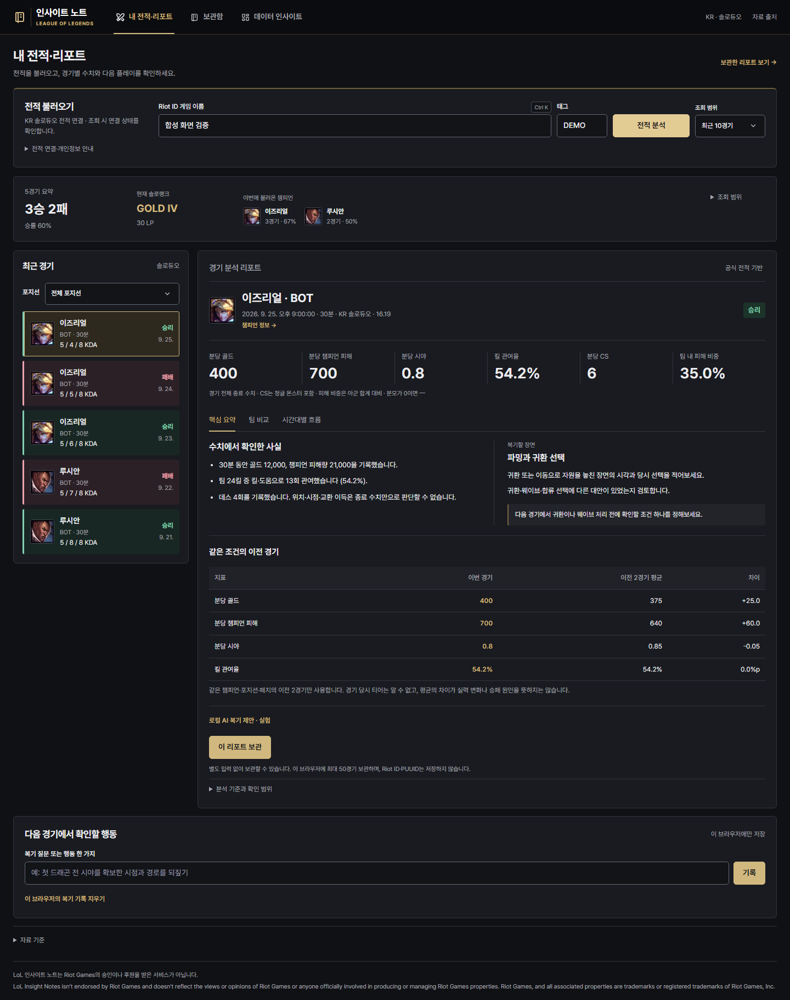
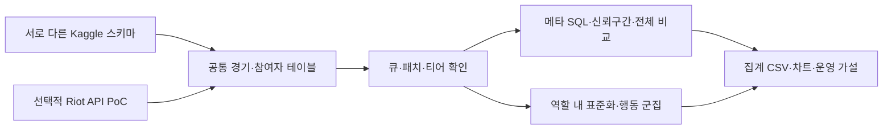
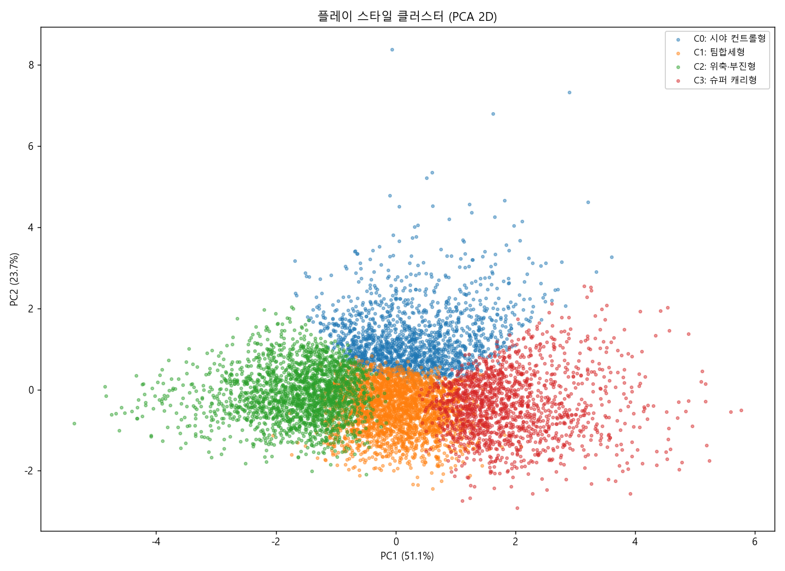

# LoL 인사이트 노트


[](https://github.com/jinwon25/lol-live-ops-analytics/actions/workflows/checks.yml)

EUN 솔로듀오 두 패치의 경기 데이터를 공통 스키마로 적재하고, **챔피언 선택 변화·메타 다양성·경기별 행동 유형**을 SQL과 Python으로 분석했습니다. 표본의 티어 구성을 제한한 비교와 전체 표본 비교를 나란히 제시해 해석의 민감도를 확인했습니다.

이 분석을 바탕으로 **본인의 랭크를 복기하고 다음 행동을 기록하는 도우미 웹서비스**를 개발 중입니다. YOUR.GG·LOL.PS·FOW·OP.GG·Mobalytics를 참고해, 장면에서 확인한 사실과 가설을 구분하고 비교 가능한 내 경기들을 다시 살펴보는 흐름에 집중합니다. [서비스 비교와 집중 방향](docs/07_service_benchmark.md)

## 문서 읽기 안내

[분석·복기 서비스 문서 안내](docs/README.md)에서 읽는 순서와 용어 풀이를 확인할 수 있습니다.

## 현재 웹서비스 — 2026-10-05

**내 전적·리포트 / 보관함 / 데이터 인사이트**로 구조를 정리했습니다. 계정으로 전적을 조회하면 경기별 6개 지표·관측 사실·복기 질문이 바로 표시됩니다. 직접 입력 화면은 제거하고 전적 조회 중심으로 정리했습니다. 공식 초상 173개·게임 아이콘·로컬 Pretendard 글꼴을 적용했습니다. 상용 사이트와 앱 공식 안내를 참고해 상단 탐색, 경기 목록과 상세의 병렬 배치, 짧은 수치 표현을 다듬었으며 넓은 화면의 오른쪽 빈 공간을 대칭 여백으로 수정했습니다. [구조·자동 리포트](docs/12_structure_and_auto_reports.md) · [상용 레퍼런스와 화면 검증](docs/15_commercial_ui_refinement.md)

LOL.PS 현재 화면과 OP.GG 공식 앱 안내를 참고해 **Gen.G 색조의 블랙·골드 테마**를 적용했습니다. 빠른 챔피언 분류 필터, 검색 단축키, 조회 경기의 승패 요약을 제공하며 미확인 결과는 승률에서 제외합니다. [컬러·탐색·대비 검증](docs/16_geng_theme_and_navigation.md)

최근 전적의 계정 요약과 **핵심 요약 / 팀 비교 / 시간대별 흐름**을 연결했습니다. 데이터 인사이트는 **현재 패치 통계 / 챔피언 도감**으로 나눴고, 공식 기술 설명과 KR 16.19 제한 표본 **282경기·2,820참여 행**의 역할별 승률·픽 비중·밴 비중을 표시합니다. 전체 KR 확정 티어는 아니며 표본·참고 구간·갱신 상태를 함께 보여줍니다. [경기 탐색·수집 구현과 검증](docs/17_match_explorer_and_riot_collection.md)



자동 리포트는 추가 입력 없이 최대 50경기 보관·재열람할 수 있습니다. 기존 수동 복기 기록은 최대 500경기와 장면·행동·수행 여부·JSON 백업·복원을 유지하며 새 직접 입력은 제공하지 않습니다. 기존 초안 저장소도 삭제하지 않습니다. 같은 조건의 수동 기록 6개부터 최근 3개/직전 3개 평균을 비교합니다. 합성 예제는 개인 기록에서 제외합니다. [기록 기능](docs/09_service_status.md) · [개인 분석](docs/10_personal_analysis_ui.md)

**Riot 공식 API의 KR 솔로듀오 최근 5/10경기 조회와 필요 시 타임라인 조회**를 구현했습니다. 모의 응답 검증과 소량 실제 계정 시뮬레이션을 구분합니다. 개인 식별자와 실제 개인 전적은 공개 파일에 포함하지 않습니다. [연동 방식](docs/08_riot_integration.md)

공개 데이터셋 13개를 출처·권리·실제 스키마까지 검토하고, CC BY 4.0 경기 흐름 자료의 검증된 **61,615경기**를 참고 집계에 반영했습니다. 2023년 팀 단위 자료이므로 최신 챔피언 티어나 개인 백분위로 사용하지 않습니다. [공개 자료 조사·검증](docs/11_public_data_research.md)

공개 모델 **17개 계열의 공식 문헌·권리·장비 적합성을 검토하고 12개 원본 모델 버전의 14개 실행 구성**을 이 PC에서 비교했습니다. 모든 공개 모델을 전수 실측한 것은 아닙니다. **Qwen3 4B Q4_K_M + llama.cpp**를 실험 기본값으로 사용하며 지표에서 복기 초점을 제안하고 질문·행동 문구는 검증된 템플릿으로 제공합니다. 작은 합성 표본의 형식·사실 보존 검증이며 실제 코칭 품질·실력 진단·승패 원인·최신 티어·LLM의 타임라인 이해는 별도 검증이 필요합니다. [확장 후보·실측·선정 근거](docs/14_model_selection_audit.md) · [초기 LoRA 실험](docs/13_local_llm_research.md)

공식 정적 자료 16.19.1, 패치 노트 26.19, 기존 EUN 경기 분석 15.1·15.3의 범위를 구분합니다.

```powershell
python -m pip install -r service/requirements.txt
python -m uvicorn service.main:app --reload --host 127.0.0.1 --port 8001
```

브라우저: http://127.0.0.1:8001 · 전적 조회에는 서버의 Riot 키가 필요합니다. [실행·구조·검증 안내](service/README.md)

전적·분석·정적 파일 연결을 확인하는 로컬 준비 상태 점검과 CI 브라우저 검증을 추가했습니다. [전적 중심 흐름·기반 점검·남은 인프라 범위](docs/18_service_foundation_and_api_only_flow.md)

## 프로젝트 한눈에 보기

| 항목 | 내용 |
|---|---|
| 의사결정 문제 | 어떤 메타 신호를 추가 점검하고, 경기별 행동 패턴을 어떻게 구분할 것인가? |
| 작업 | 2026년 5월, 단독 프로젝트 |
| 데이터 | EUN 솔로듀오 8,358경기·83,566행, 패치 15.1·15.3 위주 표본 |
| 분석 | SQLite 정규화 · SQL CTE·윈도우 함수 · 비율 신뢰구간 · HHI/Gini · 역할 내 표준화·K-means |
| 도구 | Python · pandas · scikit-learn · SQLite · matplotlib · Riot API |
| 산출물 | [분석·대시보드 CSV와 차트](outputs/) · [SQL](sql/) · [대시보드 설계](docs/05_dashboard_plan.md) · [API PoC](api/README.md) |
| 본인 역할 | 데이터 적재·SQL 분석·통계 해석·행동 군집·시각화·API 수집 PoC 전반 |
| 공개 범위 | 코드·파생 산출물·설계 기록. Kaggle 원본·SQLite DB·실제 API 키·수집 DB 제외 |

## 핵심 결과와 활용 제안

| 관측 결과 | 해석 | 제안 |
|---|---|---|
| 이즈리얼 픽률 변화 전체 `+0.35%p`, 공통 티어 `+0.13%p` | 비교 표본에 따라 변화량·순위가 달라짐 | 전체와 PLATINUM·EMERALD·DIAMOND 코호트를 함께 보고 추가 표본 확인 |
| BOT HHI `+0.004`, Gini `+0.100` | 해당 표본에서 선택 집중도·불균등도가 상승 | 다양한 패치·지역에서 같은 패턴인지 점검 |
| K=4 행동 유형 비중 약 `20% / 34% / 27% / 19%` | 한 경기의 행동 프로필 군집 | 유형별 콘텐츠·지원 가설 설계. 지속적인 플레이어 성격으로 해석하지 않음 |
| 일부 변화와 15.3 패치 조정 방향이 일치 | 이미 공개된 패치와 사후 대조 | 정합성과 미일치 사례를 함께 검토. 사전 예측 정확도로 제시하지 않음 |

두 패치의 단일 관찰 비교입니다. 티어 제한은 비교 조건을 맞추는 방법이며 다른 교란을 제거하거나 패치의 인과효과를 추정한 결과가 아닙니다. 다수 챔피언 비교의 다중검정과 경기 내 관측 의존성도 추가 검토가 필요합니다.

## 분석 흐름과 주요 판단



KDA·사망 수를 포함한 초기 군집이 승패에 가깝게 나뉘어, 행동 지표인 분당 골드·딜·시야·킬 관여율을 사용했습니다. 역할 내 표준화로 포지션 차이를 줄였습니다. K=2의 silhouette가 더 높았으나 해석 목적을 고려해 K=4를 선택했으므로, 통계적으로 최적의 군집 수라고 주장하지 않습니다.



행동 유형은 시야 관리형·교전 집중형·부진 위축형·주도 캐리형으로 해석했습니다. `player_segments.csv`라는 기존 파일명과 달리 분석 단위는 **경기×참여자**입니다. 같은 사람을 추적하는 안정적 식별자가 없어 플레이어 단위로 일반화하지 않습니다.

## 주요 문서와 파일 구조

| 경로 | 역할 |
|---|---|
| `src/` | 적재·검증·메타 분석·군집·대시보드 CSV 생성 |
| `sql/` | 스키마·뷰·집계·후보 규칙·패치 변화 쿼리 |
| `outputs/` | 저장된 파생 CSV·시각화 |
| `docs/` | 단계별 분석 근거·패치 대조·대시보드 설계 |
| `api/` | 별도 API 키로 실행하는 소량 수집 예제 |
| `service/` · `web/` | 분석 조회·개인 복기/비교·공식 전적 연결·근거 표시 도우미 |
| `tests/` | 서비스의 근거 범위·입력 경계·분모 검증 |

- [데이터 적재·표본 점검](docs/01_phase1_notes.md) · [메타 분석](docs/02_phase2_notes.md)
- [행동 군집](docs/03_phase3_notes.md) · [공식 패치와 사후 대조](docs/04_patch_notes_match.md)
- [대시보드 설계](docs/05_dashboard_plan.md) · [API 사용법](api/README.md)
- [서비스 차별화 가설·후속 분석 설계](docs/06_companion_plan.md) · [웹서비스 실행](service/README.md)
- [상용 서비스 참고·개인 복기 방향](docs/07_service_benchmark.md) · [API 연결 검토](docs/08_riot_integration.md)

Looker Studio는 연결용 CSV와 설계안까지 포함합니다. 확인된 공개 대시보드 URL은 없습니다.

## 실행 조건과 확인 방법

Python 3.11 기준입니다. 원본은 별도 이용 조건에 따라 준비하고 `data/raw/2024.xlsx`의 `league_data.csv` 시트와 `data/raw/2025.csv`로 배치합니다. 파일명과 달리 연도 비교가 아니라 2025년 초 두 패치의 비교입니다.

```bash
python -m venv .venv
# macOS/Linux: source .venv/bin/activate
# Windows PowerShell: .\.venv\Scripts\Activate.ps1
pip install -r requirements.txt
python src/load.py
python src/run_validate.py
python src/run_meta.py
python src/segment.py
python src/build_dashboard_csv.py
python src/add_kr_names.py
```

원본 없이 저장된 CSV·차트를 읽고 웹서비스를 실행할 수 있지만 전체 분석을 재실행할 수는 없습니다. 기존 SQLite 적재 PoC와 웹서비스의 전적 선택 조회는 별도 경로입니다. [API PoC 안내](api/README.md) · [웹서비스 키 설정](service/README.md)을 참고하세요. 이번 서비스 작업은 공식 정적 자료 갱신·모의 응답 검증·본인 최근 경기의 소량 실제 조회까지 확인했습니다. 최신 KR 표본의 대규모 수집과 실제 코칭 정답을 이용한 학습은 수행하지 않았습니다. 합성 자료의 LoRA 연결 실험은 코칭 품질 학습과 구분합니다.

## 한계와 후속 검증

- 단일 지역·두 패치 표본이며 패치 효과의 인과 추정이나 사전 예측 평가가 아닙니다.
- 패치 노트에 변경이 없다는 이유만으로 관측 변화를 표본 노이즈로 확정할 수 없습니다. 아이템·상대 조합 등 다른 요인을 확인해야 합니다.
- 밴 데이터가 없어 픽·승률 중심이며 자동 후보 규칙에는 사각지대가 있습니다.
- 게임별 행동 유형을 플레이어 리텐션·고정 성향으로 연결하려면 별도 식별자와 종단 검증이 필요합니다.
- 소량 API PoC의 동작 기록은 대규모 수집·운영 안정성 검증과 구분합니다.

## 참고

[라이엇 공식 2025.S1.3 패치 노트](https://www.leagueoflegends.com/ko-kr/news/game-updates/patch-2025-s1-3-notes/) · [Riot Developer Portal](https://developer.riotgames.com/)

최진원 · [GitHub](https://github.com/jinwon25)
