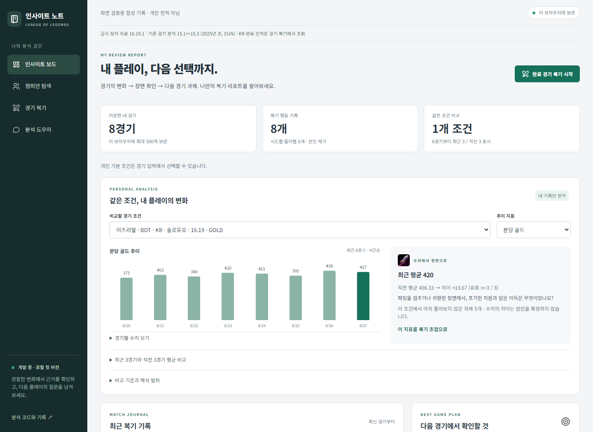
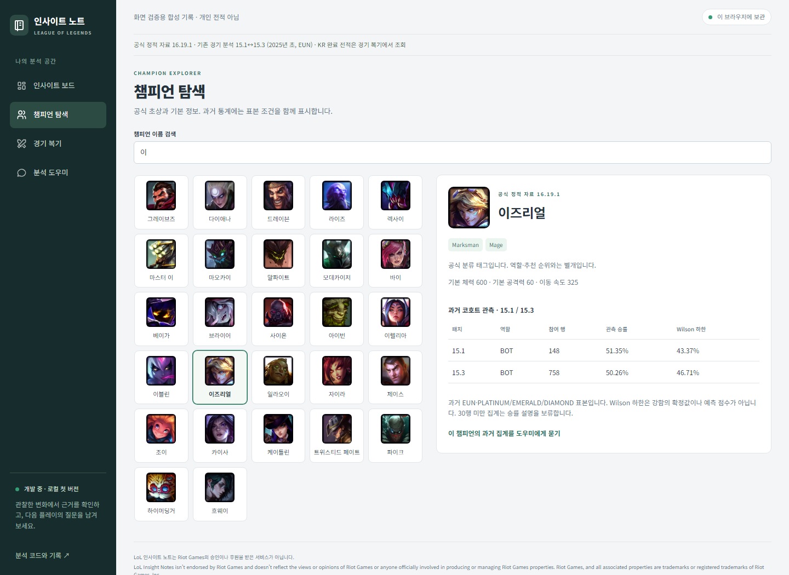
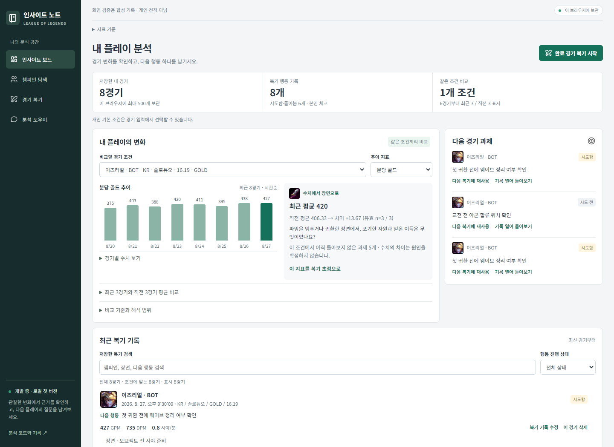
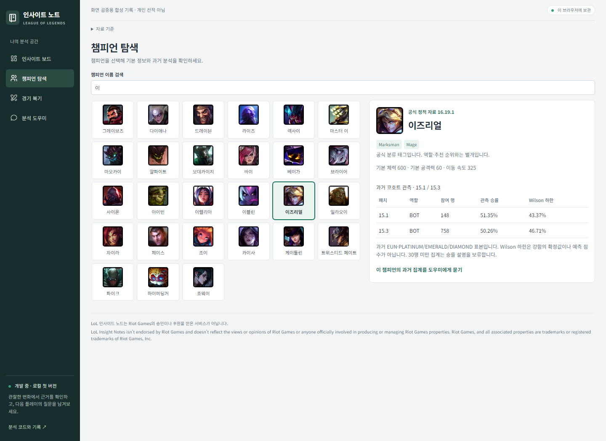
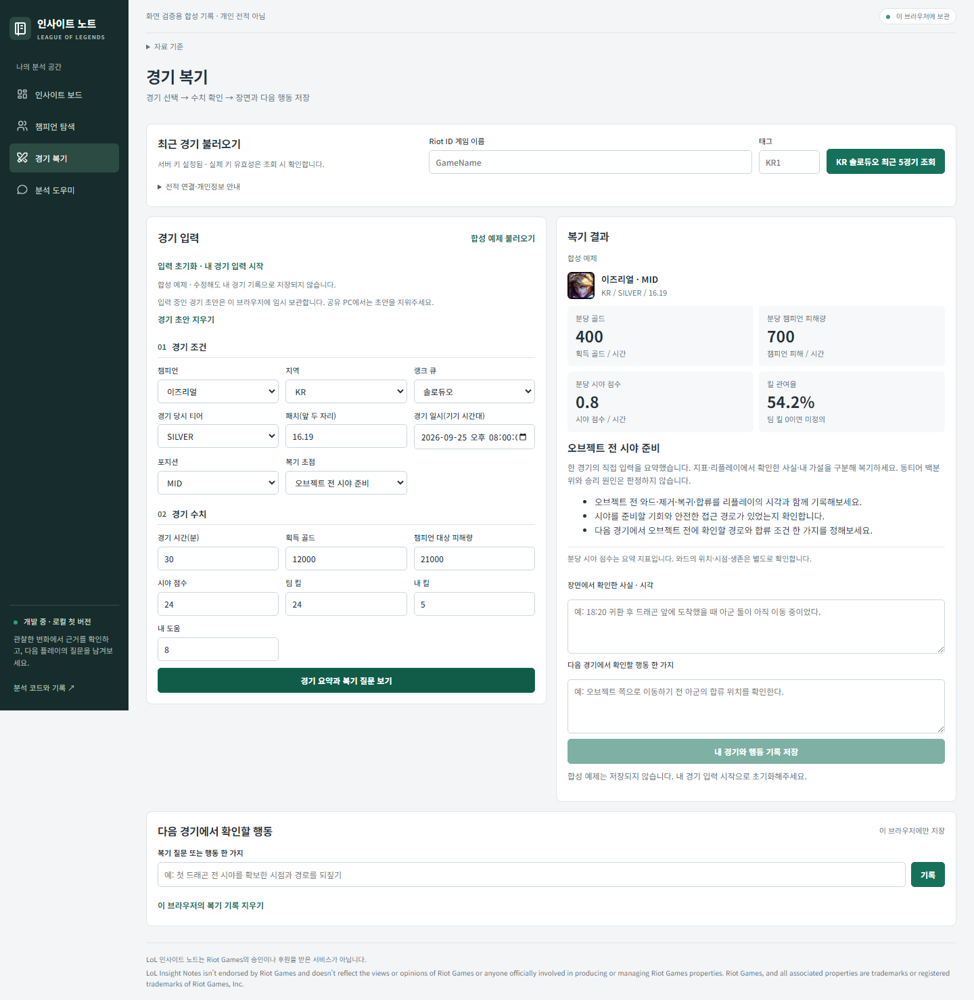

# 화면·개인 분석 개선 — 2026-10-05

**최신 화면:** 아래의 [컴팩트 화면·이미지 로딩 보강](#컴팩트-화면이미지-로딩-보강)을 추가 적용했다. 앞부분의 이미지는 첫 개선 단계의 기록이다.

완료 경기의 수치를 읽고 다음 경기 과제로 연결하는 개인 분석 공간으로 개선했다. 챔피언 이미지를 추가하고 정보 배치를 줄였으며, 유료 분석 서비스에서 기대하는 개인 리포트·복기 질문·후속 과제 흐름을 현재 보관한 기록으로 구현했다. 경쟁사의 내부 점수 계산식이나 유료 모델을 재현한 것은 아니다.

## 화면을 보고 확인한 문제와 변경

변경 전 로컬 화면을 현재 작업에서 캡처했다. 큰 제목과 설명, 비교 조건이 최근 경기보다 위에 있어 첫 화면에서 기록이 보이지 않았다. 챔피언은 이름만 나열했고, 장면·과제·수행 상태가 긴 문단으로 이어져 기록 간 차이를 읽기 어려웠다.

| 화면 | 변경 | 사용자가 확인할 것 |
|---|---|---|
| 인사이트 보드 | 짧은 제목·작업 버튼·세 개 요약 지표. 기록이 있으면 개인 리포트를 먼저 배치 | 선택한 조건의 추이와 다음 복기 초점 |
| 개인 리포트 | 최대 최근 10경기 막대 추이, 평균 차이, 지표별 장면 질문. 상세 평균은 접어서 읽기 | 실제 수치와 계산 가능한 경기 수 |
| 경기 목록 | 초상·조건·수행 상태·다음 행동·핵심 수치. 장면과 돌아본 메모는 펼치기 | 어느 경기에서 무엇을 시도할지 |
| 다음 경기 과제 | 최신 미완료 3개, 행동과 초점 재사용, 원래 기록 열기 | 이전 과제를 다시 사용하고 수행 상태 남기기 |
| 챔피언 탐색 | 공식 초상 그리드와 상세 카드 | 현재 기본 정보와 과거 표본의 구분 |
| 경기 복기 | 조건/수치 구획, 조회 폼 압축, 요약 결과에 초상 | 수치 확인 후 장면과 행동 저장 |

사진의 기록·수치는 테스트용 합성이며 개인 전적이나 실제 개선 성과가 아니다. 테스트 브라우저는 개인 기본값과 분리했고 실제 계정·키를 캡처하지 않았다. 기존 첫 버전 이미지는 과거 기록으로 보존했다.

## 참고한 자료와 접근 범위

| 참고 | 현재 작업에서 확인한 범위 | 구현에 반영한 판단 |
|---|---|---|
| [LOL.PS 챔피언 통계](https://lol.ps/statistics) | Playwright로 홈 팝업을 닫고 통계 화면 캡처·검토. 역할·패치·티어 필터, 초상과 수치의 행 배치 확인 | 초상으로 빠르게 식별하고 비교 조건을 수치와 가까이 배치 |
| [LOL.PS 멤버십 공식 소개](https://member.lol.ps/membership) | 공개 멤버십 소개 화면과 공식 문서 열람. 라인·챔피언별 솔로랭크 리포트와 피드백 안내 확인 | 개인 기록 분석 → 장면 질문 → 후속 과제 연결. 가입·결제·유료 내부 화면에는 접근하지 않음 |
| [OP.GG OP Score 공식 도움말](https://help.op.gg/hc/en-us/articles/31088715328665-OP-Score-explained) | 서비스 본 화면은 브라우저에서 403. 도움말의 경기 성과·시간별 비교 안내는 열람 | 수치 변화와 비교 기준을 함께 보여주기. 자체 OP Score나 경쟁사 시간별 모델을 구현했다고 주장하지 않음 |
| [YOUR.GG PLAYREPORT 공식 소개](https://your.gg/ko/euw/playreport) · [멤버십 소개](https://m.your.gg/ko/kr/membership?region=kr) | 본 화면과 멤버십 직접 열람은 403. 공식 도메인의 검색 결과에 남은 개인 리포트 소개를 제한적으로 확인 | 과제 재사용의 제품 방향 참고. 최신 전체 화면이나 유료 분석 품질을 검증하지 않음 |
| [Riot Data Dragon 공식 문서](https://developer.riotgames.com/docs/lol#data-dragon) | 공식 초상 경로·정적 이미지 제공 범위 확인 | 경쟁사 이미지 대신 공식 게임 정적 자료 사용 |
| [Tabler Icons 공식 저장소](https://github.com/tabler/tabler-icons) | SVG 사용 방법·MIT 라이선스 확인 | 메뉴 아이콘을 원본 파일로 보관. 손으로 만든 대체 아이콘을 사용하지 않음 |

경쟁사의 화면·문구·모델을 복제하지 않았다. 디자인 결정은 기존 녹색 강조색을 유지하면서 여백·문장·수치의 위계를 정리한 자체 구현이다. 접근 제한을 우회하거나 비공개 분석 API를 호출하지 않았다.

## 현재 개인 분석의 계산 범위

지역·큐·게임 버전·경기 당시 티어·챔피언·포지션이 모두 같은 유효 개인 기록만 사용한다. 합성 예제와 다른 조건의 경기는 제외하고 경기 일시로 정렬한다. 추이는 최신 최대 10경기, 평균 비교는 최근 3경기와 직전 3경기다. 6경기는 표시 기준이며 통계적 유의성 기준이 아니다.

분당 골드·챔피언 피해량·시야 점수·킬 관여율을 선택할 수 있다. 계산 불가 KP는 그래프에서 `—`, 평균에서 제외하고 유효 n을 표시한다. 전부 계산 불가이면 0이나 변화 없음으로 표시하지 않는다. 경기별 수치 표는 그래프와 별도로 읽을 수 있다.

지표별 질문은 고정 템플릿이다. 예를 들어 분당 골드에는 파밍·귀환 장면에서 포기한 자원과 얻은 이득을 확인하도록 안내한다. 개인의 약점·팀운·실력 향상을 확정하는 진단, 동티어 백분위, 승률 예측은 구현하지 않았다. 전체 수치만으로 교전 실패의 원인을 자동 결정하지 않는다.

과제를 재사용할 때는 행동과 초점만 복사한다. 새 경기의 일시·조건·수치를 복사하거나 원래 경기의 수행 상태를 새 경기에 붙이지 않는다. 남겨둔 초안과 합성 입력은 우선 보호하며, 저장 전 새 경기 수치의 요약을 다시 확인한다.

## 이미지와 유지보수

- Riot Data Dragon `16.19.1` 공식 챔피언 초상 173개, 투명 와드·도란의 검·도란의 방패·점멸 이미지 4개를 로컬에 보관했다. 게임 아이콘은 복기 질문의 주제를 표시하며 사용자가 실제 장착한 아이템·스펠을 뜻하지 않는다.
- Tabler Icons `3.46.0` 원본 SVG 14개와 MIT 라이선스를 보관했다. 전체 이미지 묶음은 약 4.9MB다.
- `web/images/manifest.json`에 파일별 원본 URL·바이트·SHA-256·버전을 기록했다. 출처는 보드의 공식 자료에서 확인할 수 있다.
- `scripts/sync_ui_assets.py`가 카탈로그 버전의 이미지를 갱신한다. 로컬 이미지를 우선 사용하며 실패한 초상만 동일 버전의 Riot 공식 CDN으로 한 번 재시도한다. 임의 백업 ID는 이미지 경로로 바꾸지 않으며 두 경로가 모두 실패해도 이름과 버튼은 유지한다.

## 검증 결과

Python 단위 검증 21개, Node 기록·초안·개인 분석 검증 17개와 Playwright 브라우저 흐름을 통과했다. 브라우저 검증은 네 화면, 기록 보관·수정·삭제 취소·검색·복원·초안 보호·다른 탭 충돌·과제 재사용·조건별 추이·미정의 KP·이미지 로딩 및 실패 대응을 확인했다. 320/390/768px에서 가로 넘침을 확인했고 1440px 화면도 캡처·검토했다. 전체 WCAG 적합성 인증이나 실제 코칭 효과 검증은 아니다.

## 상용 분석 수준으로 확장할 다음 데이터

1. **경기 타임라인**: 10/15분 CS·골드 차이, 귀환·오브젝트 전 준비 시점, 사망과 교전 장면을 연결한다. 현재 수치 요약만으로는 시점별 원인을 알 수 없다.
2. **비교 가능한 KR 기준 표본**: 포지션·챔피언·패치·티어·경기 길이를 맞춘 기준과 표본 수를 확보한다. 현재 개인 리포트는 자신의 과거만 비교한다.
3. **지속적인 개인 경기 보관**: 공식 경기 ID와 동의 범위, 수정 이력·출처를 설계한 뒤 로컬 DB 보관과 재분석을 연결한다. 지금 브라우저 기록의 문맥을 보존하면서 이전해야 한다.
4. **근거를 읽는 분석 응답**: 수치·표본·사건을 구조화한 뒤 LLM을 연결한다. 템플릿 질문과 모델 추론을 구분하고 실제 사용에서 과제의 구체성과 재사용률을 평가한다.

[보관·재사용 현황](09_service_status.md) · [상용 서비스 참고](07_service_benchmark.md) · [서비스 실행](../service/README.md)

## 컴팩트 화면·이미지 로딩 보강

후속 요청에 맞춰 큰 제목·영문 구획명·반복 설명을 줄였다. 자료 기준과 연결 안내는 필요한 때 펼쳐 읽도록 정리했고, 버튼·입력·카드의 간격과 강조색을 통일했다. 기존 기록과 초안의 보관 형식은 유지했다.

| 화면 | 최종 배치 |
|---|---|
| 분석 보드 | 세 지표를 한 줄로 묶고 플레이 추이와 다음 경기 과제를 나란히 표시. 아래에 검색 가능한 경기 목록 배치 |
| 기록이 없는 보드 | 경기 입력 안내를 먼저 표시. 저장 후 개인 추이·과제를 먼저 표시하도록 읽기 순서도 함께 변경 |
| 챔피언 | 데스크톱 6열 초상 목록과 상세 정보. 좁은 화면은 목록과 상세를 세로 배치 |
| 복기 | 짧은 전적 조회 영역, 조건·수치 3열 입력, 오른쪽 결과·행동 저장. 좁은 화면에서 2열 입력과 전체 폭 경기 일시로 전환 |

### 이미지 점검 결과

사용자가 이미지가 보이지 않는다고 알려준 시점에, 실행 중인 로컬 서버의 챔피언 초상 **173개 모두 HTTP 200·PNG·원본과 같은 바이트**로 전달됐다. 격리된 Chromium에서도 정상 표시되어 사용자의 기존 탭에서 발생한 원인은 재현하지 못했다. 따라서 원인을 확정하지 않고 다음 취약한 동작을 보강했다.

- 숨겨진 메뉴에 있는 초상도 미리 로드해 메뉴 전환 시 지연을 줄인다.
- 로컬 경로에 정적 자료 버전을 붙이고, 실패하면 [Riot Data Dragon 공식 초상 경로](https://developer.riotgames.com/docs/lol#data-dragon_champions)의 같은 버전으로 한 번 재시도한다.
- 두 경로가 실패해도 이름·상세 선택을 유지한다. 임의 백업 ID는 외부 이미지 요청으로 변환하지 않는다.
- HTML·앱 스크립트·스타일에 재검증 캐시 정책을 적용한다. 다시 접속하거나 새로고침하면 수정된 이미지 로더를 확인할 수 있다.

공식 경로 재시도는 외부 네트워크가 가능한 환경에서 동작한다. 정상 사용은 묶어 둔 로컬 이미지로 처리한다. 브라우저 기록은 주소·포트별로 나뉘므로 기존 기록을 계속 쓸 때는 원래 접속 주소를 유지한다.

### 최종 화면

새 화면의 기록은 격리된 브라우저에 만든 합성 기록이다. 실제 개인 기록·계정·API 키는 포함하지 않았다.

### 최종 검증

Python 21개·Node 17개 검증과 Playwright 사용자 흐름을 통과했다. 로컬 이미지 실패 → 공식 경로 성공, 두 경로 실패 → 이름과 상세 선택 유지 상황은 외부 호출 없이 모의 검증했다. 갱신된 미리보기의 네 메뉴를 1440·1280·1024·768·390·320px에서 확인했고 가로 넘침이 없었다. 미리보기에서 초상 173개가 모두 디코딩됐고 앱 파일의 `Cache-Control: no-cache` 응답도 확인했다. 변경 전후 화면은 직접 검토했다.
