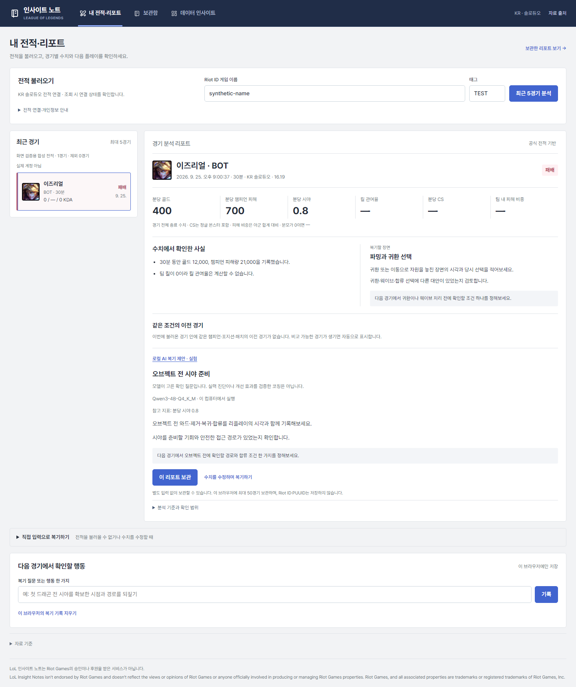

# 로컬 LLM 비교·선정·학습 실험 — 2026-10-05

이 문서는 초기 6개 구성의 측정 기록이다. 추가 후보와 최신 선정 근거는 [공개 모델 비교 범위 재점검](14_model_selection_audit.md)을 따른다. 초기 Transformers와 GGUF의 한국어 요약 지시는 서로 달랐으므로 해당 요약을 동일 프롬프트의 직접 비교로 해석하지 않는다.

이 서비스의 모델 작업은 **공식 종료 통계에서 복기할 질문을 고르는 것**이다. 수치 계산과 관측 사실 생성은 Python이 담당한다. 장면을 보지 않은 모델이 실력·승패 원인을 단정하거나 최신 챔피언 티어를 만들어내도록 하지 않는다. 한국어 생성은 별도 비교 과제로 평가하되, 제품에는 검증된 질문 문구를 사용한다.

## PC와 비교 조건

이 PC는 약 16GB RAM, Intel Iris Xe 내장 그래픽이며 NVIDIA CUDA 실행 환경이 없다. 작은 모델은 PyTorch 2.7.1+cpu에서 CPU 4스레드·FP32·greedy·비사고 모드로 비교했다. 기존 서비스의 Transformers 4.57.6과 분리한 `.local/benchmark-venv`에 Transformers 5.18.0을 설치했다. 추가로 공식 Qwen3 4B Q4_K_M을 llama.cpp b11398의 Windows x64 CPU 실행 파일에서 같은 4스레드·입력·출력 길이·greedy·비사고 조건으로 측정했다.

양자화는 더 큰 모델의 가중치 저장량을 줄이는 경로이므로 FP32 비교만으로 후보를 제한하지 않았다. 공식 Qwen GGUF 커밋·모델 SHA256과 [공식 llama.cpp 릴리스](https://github.com/ggml-org/llama.cpp/releases/tag/b11398)의 archive SHA256을 기록했다. 운영체제 전체 설치나 기존 환경 변경 없이 `.local/`에 실행 파일을 보관했다.

공식 저장소의 커밋 SHA를 고정해 다운로드하고 각 파일 SHA256·이용 조건을 로컬 manifest에 남겼다. 외부 추론 API, 실제 계정·PUUID·실제 경기·개인 복기 메모는 평가에 사용하지 않았다. 모델끼리 순서대로 실행해 메모리와 CPU 경쟁을 줄였다.

평가 입력은 5개 역할, 팀 킬 0으로 관여율 미정의, CS·피해 비중 누락, 시야 점수 0의 구조화 과제 8개와 한국어 요약 3개다. 출력은 각각 최대 64·96토큰이며 생성 시간 제한은 30초다. `max_time`은 토큰 계산 사이에서 검사하므로 엄격한 OS 실행 시간 보장은 아니다. 웹 실행에는 별도 프로세스 75초 종료 제한을 둔다.

이 작은 평가로 모든 모델·모든 한국어·실제 코칭 품질에서 절대 최적을 확정할 수 없다. 여기서 선정하는 모델은 **실제로 비교한 후보 중 현재 PC·짧은 근거 중심 리포트에 사용할 실험 기본값**이다. 반복 측정·장기 문맥·다중 접속·양자화 성능은 아직 별도 평가하지 않았다.

## 공식 후보와 이용 조건

| 후보 | 확인한 공식 자료 | 판단 |
|---|---|---|
| Qwen3 0.6B·1.7B | [0.6B 모델 카드](https://huggingface.co/Qwen/Qwen3-0.6B), [1.7B 모델 카드](https://huggingface.co/Qwen/Qwen3-1.7B) · Apache 2.0 · 비사고 모드 지원 | 둘 다 실측. 작은 기준 모델과 용량 증가의 실제 효용을 비교 |
| Qwen3.5 0.8B | [공식 카드](https://huggingface.co/Qwen/Qwen3.5-0.8B) · Apache 2.0 · 201개 언어·방언 · 프로토타입·작업별 학습 용도 안내 | 실측. 텍스트 입력만 사용. 시각 모델을 탑재했다고 경기 화면 분석을 구현한 것은 아님 |
| LFM2.5 1.2B Instruct | [공식 카드](https://huggingface.co/LiquidAI/LFM2.5-1.2B-Instruct) · 한국어 포함 8언어·edge/CPU 지향 | 실측. [LFM Open License v1](https://huggingface.co/LiquidAI/LFM2.5-1.2B-Instruct/raw/main/LICENSE)의 상업 권한에 매출 기준 조건이 있어 Apache와 구분 |
| Qwen2.5 1.5B Instruct | [공식 카드](https://huggingface.co/Qwen/Qwen2.5-1.5B-Instruct) · Apache 2.0 · 한국어·JSON 출력 안내 | 문헌 후보. 이번 실측은 더 최근 계열과 구조가 다른 LFM을 우선. 실측 성능 순위에는 넣지 않음 |
| Qwen3 4B Instruct 2507 | [공식 카드](https://huggingface.co/Qwen/Qwen3-4B-Instruct-2507) · Apache 2.0 | FP32 가중치만 약 16GB라 현재 RAM에 여유가 없음. CPU 양자화 대안은 후속 실측 대상이며 GPU 필수라고 주장하지 않음 |
| Qwen3 4B Q4_K_M | [Qwen 공식 GGUF 카드](https://huggingface.co/Qwen/Qwen3-4B-GGUF) · Apache 2.0 | **추가 실측·채택**. 4B Instruct 2507과 다른 Qwen3 4B이며, 공식 제공 Q4_K_M 파일 2,497,280,256bytes를 사용 |
| EXAONE 4.0 1.2B | [공식 카드](https://huggingface.co/LGAI-EXAONE/EXAONE-4.0-1.2B), [EXAONE 1.2 NC 원문](https://huggingface.co/LGAI-EXAONE/EXAONE-4.0-1.2B/raw/main/LICENSE) | 한국어·소형 장점. 공개 가중치의 비상업 조건 때문에 유료 서비스 기본 후보에서 제외. 별도 상업 권한과 구분 |
| Gemma 3 1B IT | [공식 카드](https://huggingface.co/google/gemma-3-1b-it) | 이용 조건 동의가 필요한 gated 다운로드. 계정·동의를 대신 사용하지 않았으며 실측하지 않음 |
| Gemma 4 E2B | [Google 공식 카드](https://ai.google.dev/gemma/docs/core/model_card_4), [가중치 카드](https://huggingface.co/google/gemma-4-E2B-it) · Apache 2.0 | 유효 파라미터 2.3B와 PLE 포함 총 5.1B를 구분. 현재 FP32 경로의 메모리 후보에서 제외. Gemma 3 조건을 그대로 적용하지 않음 |
| Phi 4 mini Instruct | [Microsoft 공식 카드](https://huggingface.co/microsoft/Phi-4-mini-instruct) · 3.8B | 한국어 포함 다국어 후보. 현재 FP32 CPU 메모리 여유가 적어 양자화 후 별도 비교할 후보 |

공식 일반 벤치마크는 후보 탐색에 사용했다. 공급자의 GPU·특정 AMD CPU 토큰 속도를 이 PC의 속도로 표시하지 않는다. 한국어 지원 표기는 LoL 용어·원인 진단·사실 보존의 정확도를 보장하지 않는다.

## 실측 결과

**실험 기본값은 Qwen3 4B Q4_K_M + llama.cpp b11398**다. 비교한 모델 5개·LoRA 포함 6구성 중 구조·근거 검증, 한국어 조건 보존, CPU 속도·메모리의 균형이 가장 적합했다. [`local_model_selection.json`](../service/data/local_model_selection.json)에 선정값과 고정 revision을 기록해 서비스가 실제로 사용한다.

| 실행 구성 | 원문 JSON·근거 검증 | 코드 블록 보정 후 | 생성 중앙값¹ | 최대 작업 메모리² | 모델 준비³ |
|---|---:|---:|---:|---:|---:|
| Qwen3 0.6B FP32 | 0/8 | 8/8 | 9.468초 | 3.325GiB | 5.61초 |
| Qwen3 1.7B FP32 | 8/8 | 8/8 | 15.109초 | 6.516GiB | 27.09초 |
| Qwen3.5 0.8B FP32 | 6/8 | 6/8 | 12.093초 | 3.819GiB | 4.78초 |
| LFM2.5 1.2B FP32 | 0/8 | 0/8 | 14.156초 | 4.849GiB | 6.27초 |
| Qwen3 0.6B + 10스텝 LoRA | 8/8 | 8/8 | **5.531초** | 3.337GiB | 7.47초 |
| **Qwen3 4B Q4_K_M** | **8/8** | **8/8** | **7.000초** | **4.478GiB** | **9.59초** |

¹ 각 구성의 서로 다른 합성 과제 11개(구조 8·한국어 3) 생성 시간 중앙값. 로딩 제외·반복 측정 없음. 초점 질문 선택의 정답률이나 대규모 서비스 지연 지표가 아니다. ² Windows 프로세스 peak working set. FP32는 Python 모델 프로세스, Q4는 llama-server 프로세스이고 작은 HTTP 클라이언트 메모리는 제외한다. ³ FP32는 모델 로딩, Q4는 프로세스 시작부터 health 준비까지여서 직접 같은 작업의 로딩 속도로 해석하지 않는다. Q4의 30초 제한은 HTTP 전체 대기 기준이며 Transformers의 토큰 경계 제한과 다르다. 실행 시 OS 캐시·백그라운드 상태에 따른 변동도 남는다.

한국어 원문 검토에서 0.6B·LoRA는 관여율 계산 불가와 당시 티어 미확인 조건을 생략했다. 1.7B도 조건을 놓쳤고 `이전 경기 평균`을 `전반기 평균`으로 바꿨다. Qwen3.5는 계산 불가를 보존했지만 null 지표를 선택한 2건이 거부되었고, 골드 차이 설명에 `차이로 인해`라는 근거 없는 원인 문구를 넣었다. LFM은 focus_id 대신 role을 출력하거나 지표를 3~4개 나열했으며 한국어에 `골수량` 같은 용어 오류가 있었다.

4B Q4는 구조 검증 8/8, 세 한국어 과제의 입력 수치 보존과 추가 수치 없음, 계산 불가·티어 미확인 조건 보존을 확인했다. 다만 정상 경기 요약은 두 문장 지시를 지키지 않았고, 구조 과제에서도 모두 vision을 골랐다. 더 좋은 코칭 초점·긴 리포트·패치 지식의 검증을 대신하지 않는다. 속도가 가장 빠른 LoRA를 채택하지 않은 이유는 이 정보 보존과 의미 품질 차이다. 제품에는 자유 생성 문장을 직접 출력하지 않고 검증된 질문을 사용한다.

원문과 환경·커밋·초 단위 결과는 [평가 파일](../outputs/model-benchmark/)에 보관한다. strict JSON과 형식 보정을 구분한다. 보정은 출력 전체를 감싼 정확한 Markdown JSON 코드 블록만 제거한다. 임의 본문에서 JSON을 추출하거나 잘못된 지표 키를 고치지는 않는다. 모든 후보의 원문에 같은 검증을 재적용한다.

한국어 자동 검사는 지정 수치 포함·입력에 없는 수치·문자 비율을 확인한다. 이것은 의미 정확도 평가가 아니다. 원문을 함께 읽어 미정의 값·티어 미확인 조건 누락, 비교 범위 변경, 문장 수 지시 위반을 기록한다. 역할별 정답 코칭 라벨이 없으므로 구조화 초점 선택의 정답률로 포장하지 않는다.

## LoRA 실험과 실제 채택의 구분

Qwen3 0.6B에 CPU LoRA를 실제 적용했다. q_proj·v_proj, r=8, alpha=16, dropout=0.05, AdamW 2e-4, seed=17, 10스텝이다. 목표 토큰에만 loss를 계산하고 프롬프트는 -100으로 마스킹했다. 50개 합성 예제를 지표 조건 그룹으로 40개 학습·10개 보류로 나눴다.

40개는 학습용 풀의 크기다. 실제 10스텝에서는 그중 앞의 10개를 1회씩 사용했으므로 40개 전체를 학습했다고 해석하지 않는다.

10스텝 학습은 약 48.3초, 학습·보류 평가 전체는 약 91.5초였다. 보류 출력 형식은 10/10이지만 준비한 역할 우선 라벨 일치는 6/10이었다. 정글·서포터도 resource로 고른 사례가 있었다. 이 라벨은 작성한 구조 학습용 규칙이고 전문가의 최적 복기 정답이 아니다. 어댑터는 `.local/models/lol-coach-smoke`에 보존하며 기본 모델과 같은 추가 평가로 비교한다. 실제 개인 코칭 데이터 학습이나 개선 효과 검증으로 소개하지 않는다.

학습 방법 근거: [PEFT 공식 안내](https://huggingface.co/docs/peft/en/quicktour), [TRL SFTTrainer](https://huggingface.co/docs/trl/main/en/sft_trainer), [LoRA 원논문](https://arxiv.org/abs/2106.09685). LoRA가 학습할 파라미터를 줄여도 기반 모델 메모리·CPU 시간·라벨 품질 문제는 남는다.

## 서비스 실행 구조

기본 리포트는 모델을 기다리지 않고 바로 표시한다. `로컬 AI 복기 제안 · 실험`을 누르면 역할과 6개 지표만 로컬 API로 전달한다. 모델의 출력은 focus_id와 실제 존재하는 지표 키 1~2개로 제한한다. 없는 값의 지표·추가 문장·중복 키·잘못된 초점은 거부한다. 화면에는 canonical 질문·행동 문구와 서버가 계산한 지표를 표시한다.

채택한 모델은 요청 동안만 localhost 임시 포트의 llama-server 프로세스를 실행하고 응답·오류 후 정확히 해당 자식 프로세스를 종료해 메모리를 반환한다. 다른 서비스나 기존 서버를 종료하지 않는다. 모델 파일은 로컬 경로에서 읽고 외부 추론 API를 호출하지 않는다. FP32 대안은 격리된 Python 프로세스로 실행한다. 고정 모델 이름·공식 manifest revision이 맞아야 실행한다. 동시에 한 요청만 허용하고 시간 초과·환경 오류·출력 오류는 503으로 처리한다. 오류가 기본 경기 리포트·보관 기능을 지우지 않는다. 사용자의 계정·메모·응답을 학습 파일로 축적하지 않는다.

4B 모델에 0.6B LoRA를 적용하지 않았다. 이 PC의 CPU·RAM에서 4B 학습까지 완료했다고 주장하지 않는다. 기본 4B의 제약된 추론을 먼저 연결하고, 전문가 검증 라벨과 학습 자원이 확보되면 해당 모델의 학습 전후를 다시 평가한다.

실제 8001 API에 계정 없는 합성 입력을 보내 200·no-store·null 지표 제외를 확인했다(한 요청 전체 10.8초). 브라우저에서도 합성 전적과 실제 모델을 연결해 결과 표시·입력의 식별자 제외·320/390/768/1024/1440px 배치를 확인한다. 모델 호출 모의 테스트와 실제 실행 검증을 구분한다.



## 공식 활용 사례와 적용 범위

| 연구 | 확인한 범위 | 여기서 적용할 것 |
|---|---|---|
| [Wang·Yoshinaga, NAACL 2024](https://aclanthology.org/2024.naacl-srw.28/) | 구조화된 LoL 경기 기록에서 해설 생성 | 구조화 사실과 생성 설명 분리. 해설 성능을 개인 코칭 효과로 해석하지 않음 |
| [LoL 멀티모달 중요 장면 연구, 2025](https://aclanthology.org/2025.findings-ijcnlp.112/) | 화면·구조화 정보로 경기 장면 설명 | 향후 타임라인·화면 증거를 함께 쓰는 경로. 종료 수치만으로 장면을 복원하지 않음 |
| [LeagueBot, 2026](https://arxiv.org/abs/2602.01213) | 초보자 33명 대상 게임 지원 실험 | 짧은 제안과 인지 부담을 고려. 랭크 상승·우리 모델 성능 근거로 사용하지 않음 |

이 연구들의 모델·데이터를 그대로 제품에 포함한 것은 아니다. 공개 논문과 공개 데이터셋 이용 권한은 별개다. 최신 패치 지식은 향후 공식 출처 검색·검증 계층에서 주고, 변하는 경기 지식을 파인튜닝 가중치 하나에 고정하지 않는다.

## 재현

```powershell
# 서비스 환경과 분리. 현재 PC의 기존 torch CPU 설치를 참조했다.
python -m venv --system-site-packages .local/benchmark-venv
.local/benchmark-venv/Scripts/python.exe -m pip install transformers==5.18.0
python scripts/download_local_model.py --model Qwen3-0.6B
python scripts/download_local_model.py --model Qwen3-1.7B
python scripts/download_local_model.py --model Qwen3.5-0.8B
python scripts/download_local_model.py --model LFM2.5-1.2B-Instruct
$env:HF_HUB_OFFLINE='1'
.local/benchmark-venv/Scripts/python.exe scripts/benchmark_local_models.py --model Qwen3-0.6B
.local/benchmark-venv/Scripts/python.exe scripts/benchmark_local_models.py --model Qwen3-1.7B
.local/benchmark-venv/Scripts/python.exe scripts/benchmark_local_models.py --model Qwen3.5-0.8B
.local/benchmark-venv/Scripts/python.exe scripts/benchmark_local_models.py --model LFM2.5-1.2B-Instruct
.local/benchmark-venv/Scripts/python.exe scripts/benchmark_local_models.py --model Qwen3-0.6B --adapter
python scripts/setup_quantized_model.py
python scripts/benchmark_quantized_model.py
python scripts/summarize_model_benchmarks.py
```

학습 연결 실험은 별도 `.local/llm-deps`의 peft 0.18.1·accelerate 1.12.0을 사용했다. `python scripts/train_local_coach.py --steps 10`, 기존 어댑터는 `--evaluate-only`로 평가한다. 스크립트가 기존 어댑터를 덮어쓰지 않는다. 모델·원본 가중치·합성 학습 파일·개인 설정은 Git 제외 경로 `.local/`에 둔다.

다음 품질 고도화는 라이선스·동의를 확인한 전문가 복기 라벨, 시간순·계정별 데이터 분리, 경기 장면 근거, 근거 누락·과도한 단정·행동 실행 가능성의 평가 세트를 먼저 만드는 것이다. 그 뒤 선택한 모델의 LoRA와 기본 모델을 같은 보류 경기로 다시 비교한다.
