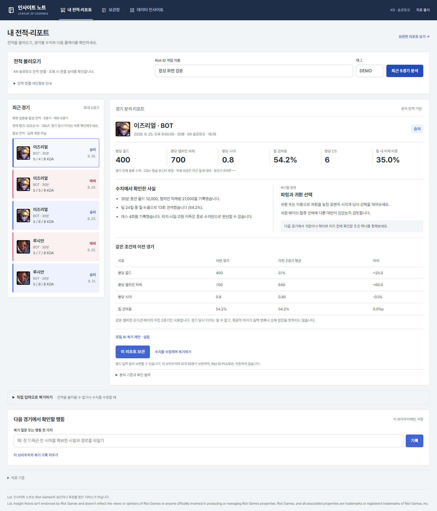
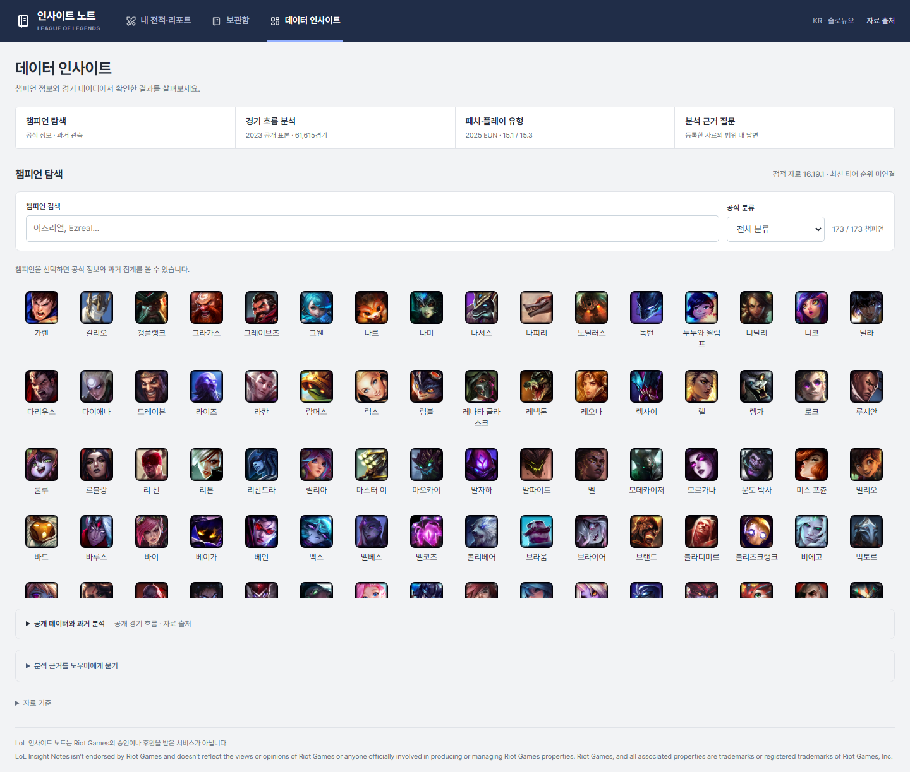

# 상용 서비스 참고와 화면 밀도 개선

2026-10-05, 기존 서비스를 실행하고 변경 전 화면을 캡처한 뒤 수정했다. 개발 서버는 `http://127.0.0.1:8001`이다. 이미지의 전적·랭크는 합성 응답이며 실제 계정을 조회하지 않았다.

## 관찰한 문제와 변경

| 변경 전 문제 | 적용한 변경 | 확인 방법 |
|---|---|---|
| 고정 왼쪽 메뉴와 본문의 최대 너비 때문에 큰 화면의 오른쪽만 비었다 | 상단 탐색 메뉴와 중앙 정렬 본문, 본문 최대 1,840px | 1,920·2,560px에서 본문 경계 측정 |
| 다섯 경기 목록을 모두 지나야 리포트가 나왔다 | 데스크톱은 경기 목록과 상세를 나란히 배치 | 첫 화면에 선택 경기·핵심 지표·관측 사실 표시 |
| 경기마다 날짜·챔피언·결과가 긴 한 줄이었다 | 초상·챔피언·포지션·시간·K/D/A·결과·날짜의 고정 배치 | 승패 색과 텍스트를 함께 표시, 결과 미확인은 패배로 취급하지 않음 |
| 카드·색 패널·영문 소제목과 같은 안내가 반복됐다 | 중립적인 구분선, 작은 제목, 지표 설명 한 줄로 통합 | 사실·복기 질문·동일 조건 비교가 구분됨 |
| 챔피언 선택 전 빈 상세 칼럼이 크게 남았다 | 선택 전 목록이 전체 폭을 사용하고 선택 시 상세가 열림 | 상세 닫기 후 목록에 키보드 초점 복귀 |
| 리포트 보관함을 열어도 이전 전적의 선택 표시가 남았다 | 보관 리포트 열기 시 조회 목록의 선택 표시 해제 | 리포트와 목록의 선택 상태 혼동 방지 |

2,560px의 이전 본문은 왼쪽 여백 190px, 오른쪽 여백 780px이었다. 변경 후 양쪽 모두 360px이다. 1,920px는 양쪽 40px이다. 초대형 화면까지 글을 무한히 늘리기보다 양쪽 여백을 맞추고 최대 너비 안에서 목록과 상세가 공간을 사용하게 했다.

모바일은 목록 다음에 상세가 표시된다. 다른 경기 선택 시 상세로 이동한다. 데스크톱에서는 목록을 선택할 때 페이지를 강제로 내려 목록을 잃지 않는다. 계정 검색·보관함·데이터 인사이트의 세 가지 작업 구분은 유지했다.

## 실제 확인한 레퍼런스

| 자료 | 확인 범위 | 반영한 원칙 |
|---|---|---|
| [LOL.PS 챔피언 랭킹](https://lol.ps/statistics) | Playwright 방문 200, 현재 화면 캡처·검토 | 상단 탐색, 범위 필터와 표의 역할 구분, 지표의 일정한 정렬 |
| [FOW.LOL](https://www.fow.lol/) | Playwright 방문 200, 현재 화면 캡처 | 검색과 주요 정보 우선, 챔피언 이미지와 짧은 수치 표시 |
| [Blitz LoL](https://blitz.gg/lol) | Playwright 방문 200, 현재 화면 캡처·검토 | 일관된 상단 검색·탐색과 이미지 중심의 정보 구분 |
| [OP.GG 앱 공식 안내](https://help.op.gg/hc/en-us/articles/48467238743961-Getting-Started-with-the-OP-GG-App) | 공식 기능 설명과 제공 데스크톱 화면 확인 | 자동 데이터 연결을 먼저 제공하고 수동 입력은 보조 작업으로 둠 |
| [OP.GG 경기 상세 공식 안내](https://help.op.gg/hc/en-us/articles/31091817743129-Viewing-detailed-match-data) | 설명과 제공 이미지 확인; 이 자료의 이미지는 프로 경기 상세임 | 경기 목록에서 상세로 연결, 수치·타임라인·근거를 별도 단위로 읽기 |
| [Mobalytics 공식 앱 안내](https://mobalytics.gg/lol/guides/mobalytics-beginners-guide) | 공식 문헌의 Post Game·Profile 흐름 확인; 이미지 원본 접근 403 | 특정 경기 복기와 누적 변화의 화면 구분, 과거 경기 다시 열기 |

OP.GG 메인/다운로드, YOUR.GG, Mobalytics 앱 소개, Porofessor 다운로드는 이 환경의 브라우저에서 403 또는 보안 확인 화면이 나왔다. 해당 화면을 직접 검토했다고 기록하지 않는다. 앱을 설치·실행한 검증도 아니다. 공식 안내에 있는 흐름과 실제 확인 가능한 웹 화면을 참고했다. 외부 로고·서비스 고유 화면·독점 점수는 복제하지 않았다.

상용 서비스의 개인 점수·티어 백분위·승패 원인 설명은 현재의 작은 비교 표본으로 대신 만들지 않았다. 공식 전적의 수치, 비교 가능한 내 이전 경기, 사용자가 검토할 질문을 표시한다. 공개 데이터의 시기·지역·표본 제한도 유지했다.

## 변경 화면

[모바일 경기 리포트](images/commercial-report-mobile.png)

## 검증

`python scripts/check_service_ui.py`로 계정 조회 모의 응답, 자동 리포트, 리포트 보관, 수동 복기, 초안 보호, 검색·수정·삭제 취소·백업 복원, 다른 탭 충돌, 이미지 로딩·실패 대응을 검증했다. 320·390·768·1,024·1,440·1,920·2,560px에서 세 화면의 가로 넘침과 대칭 여백을 확인했다. 메뉴의 방향키 이동, 상세 닫기 후 초점 복귀를 검증했다.

별도 합성 응답 검사에서 7개 화면 폭 × 5경기의 키보드 선택 35회를 확인했다. 결과·데스 누락을 미확인·`—`로 표시하고, 선택 표시와 실제 리포트가 함께 바뀌며, 조회 실패 후 로딩을 지우고 재시도할 수 있었다. 검사 중 승패 누락 응답에 빈 CSS 클래스를 추가해 목록을 지우던 오류를 수정하고 기존 UI 회귀 검사에도 누락 응답을 포함했다. Python 34개·JavaScript 20개 테스트를 통과했고, 합성 경기 화면에서 실제 Qwen3-4B 호출·계정 정보 미전달도 확인했다.

브라우저 화면 점검과 키보드 검증을 수행했으며, 전문 스크린리더·색각 사용자 실사용 평가나 전면 접근성 인증은 수행하지 않았다. 변경 전·후 전체 캡처와 레퍼런스 접근 결과는 공개 저장소에서 제외한 `outputs/_tmp/commercial-refinement/`에 보관한다.
