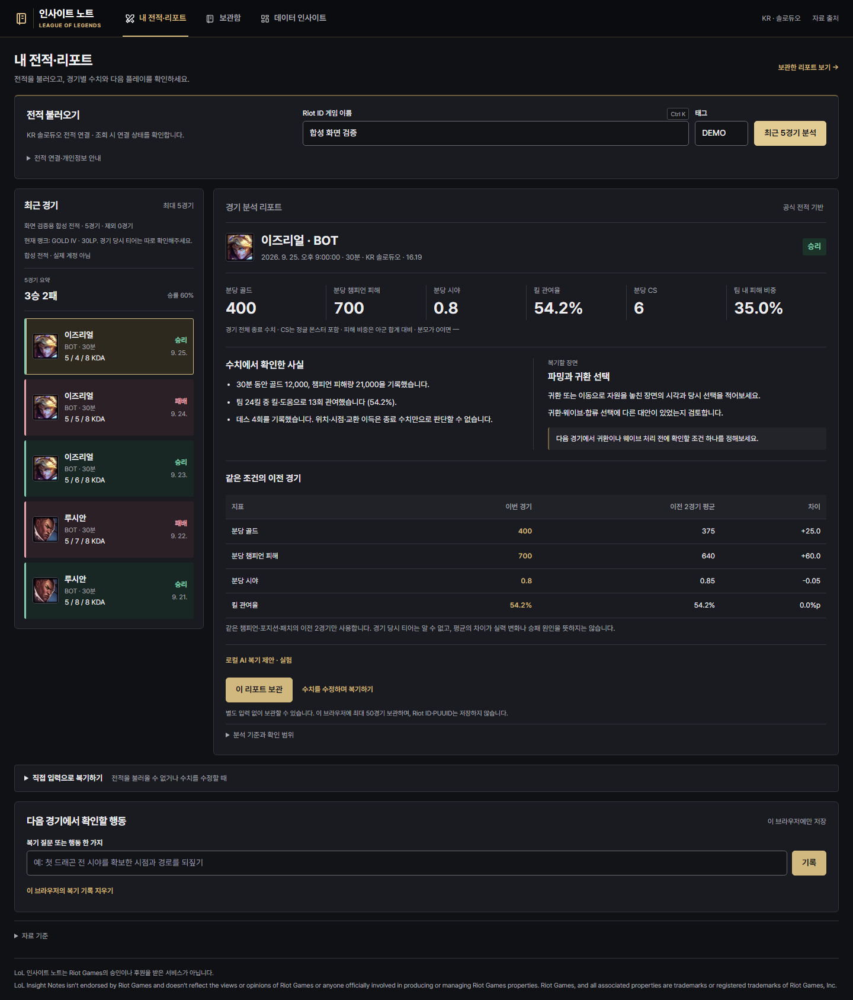
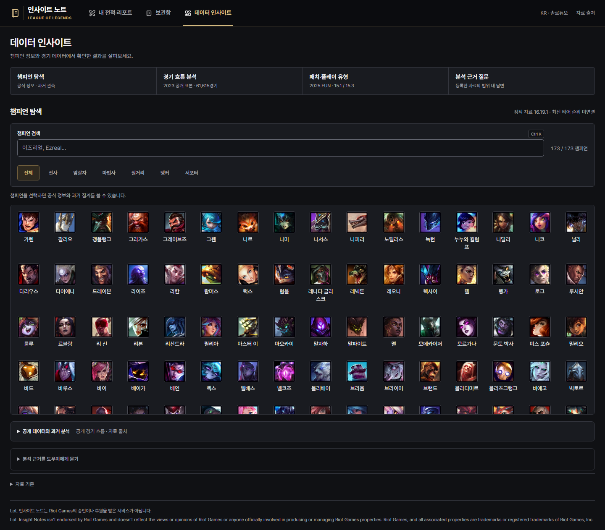

# Gen.G 컬러와 검색·챔피언 탐색 개선

2026-10-05. 기존 서비스에 Gen.G 팬의 선호를 반영해 블랙·차콜·골드 테마를 적용했다. [로컬 화면](http://127.0.0.1:8001)에서 확인할 수 있다. 아래 전적·랭크는 모두 화면 검증용 합성 응답이다.

## 확인한 화면과 적용한 원칙

| 참고 자료 | 실제 확인 범위 | 반영한 변경 |
|---|---|---|
| [Gen.G 공식 사이트](https://geng.gg/) | 브라우저 200, 공식 로고와 골드·검정 색조 캡처 | 블랙 상단 메뉴, 차콜 본문·패널, 샴페인 골드 버튼·선택 표시 |
| [LOL.PS 챔피언 랭킹](https://lol.ps/statistics) | 브라우저 200, 현재 검색·필터·표 화면 확인 | 빠른 분류 필터, 검색 단축키, 촘촘한 이미지 목록, 수치 정렬 |
| [OP.GG 앱 공식 안내](https://help.op.gg/hc/en-us/articles/48467238743961-Getting-Started-with-the-OP-GG-App) | 공식 설명과 제공 데스크톱 화면 확인 | 검색을 우선 제공하고 메뉴·분석 영역을 명확히 구분 |
| [OP.GG 상세 안내](https://help.op.gg/hc/en-us/articles/31091817743129-Viewing-detailed-match-data) | 경기 목록에서 상세로 이동하는 공식 문헌 확인 | 선택 경기와 핵심 수치·비교를 한 리포트에 연결 |

OP.GG 웹 본문은 이번에도 브라우저에서 403이었다. 본문을 직접 확인했다고 취급하지 않고 공식 안내와 제공 이미지에 근거했다. 상세 안내에 등장하는 자료는 프로 경기 상세이며, 개인 전적 서비스와 같은 기능을 구현했다고 표현하지 않는다. LOL.PS의 실제 포지션 필터는 정보 배치의 참고다. 우리 화면의 필터는 Riot 정적 자료의 **공식 분류**이며 최신 티어·추천 포지션 필터가 아니다.

## 색상과 정보의 우선순위

| 용도 | 적용 값 |
|---|---|
| 페이지 배경 | `#101114` |
| 카드·표·탐색 패널 | `#191B20` |
| 보조 패널 | `#22242A` |
| 골드 강조 | `#D1B87F` |
| 주요 글자 | `#ECECEF` |
| 보조 글자 | `#A6A7B0` |

골드 값은 공식 사이트 로고 화면에서 관측한 톤을 기준으로 정한 서비스 토큰이다. 팀 로고를 서비스 로고로 사용하지 않고 기존 브랜드와 실제 게임 이미지를 유지했다. 골드는 버튼·현재 메뉴·선택 경기·이번 경기 비교값에 사용한다. 승리와 패배는 각각 민트·로즈 색과 텍스트로 구분해 선택 상태와 혼동하지 않게 했다.

본문·폼·표·보관함·초안·오류·빈 화면까지 같은 토큰을 적용했다. 운영체제 기본 입력창도 어두운 색상 체계로 표시한다. 배경색 변경에 그치지 않고 입력 테두리, 오류 글자, 자동완성, 스크롤바, 버튼 위에 마우스를 올린 상태, 키보드 초점을 함께 조정했다. 테마는 [geng-theme.css](../web/geng-theme.css)에 분리해 기존 레이아웃과 함께 제공한다.

## 사용 흐름의 변경

1. **검색:** `Ctrl+K` 또는 `Meta+K`를 누르면 현재 화면의 계정·챔피언·보관함 검색으로 이동한다. 계정과 챔피언 검색에 단축키를 표시한다.
2. **전적:** 불러온 경기 위에 승·패와 승률을 보여준다. 결과 미확인 경기는 개수를 명시하고 승률 분모에서 제외한다. 모두 미확인이면 승률은 `—`다. 작은 최근 조회 표본의 요약이며 실력 평가 점수가 아니다.
3. **리포트:** 핵심 수치는 밝은 글자로 표시하고, 이전 경기 비교의 숫자를 오른쪽에 맞춘다. 이번 경기 값만 골드로 강조해 비교 기준을 빠르게 읽게 했다.
4. **챔피언:** 데스크톱은 전체·전사·암살자·마법사·원거리·탱커·서포터의 빠른 버튼을 제공한다. 모바일은 같은 상태를 공유하는 드롭다운으로 공간을 줄인다. 버튼을 선택한 뒤 키보드 초점이 사라지지 않는다.

최대 너비 1,840px와 대칭 여백을 유지한다. 1,920px에서 양쪽 40px, 2,560px에서 양쪽 360px이다. 기존 계정 조회·리포트 보관·수동 복기·초안·백업·이미지 로딩 기능을 유지했다.

## 변경 화면

[모바일 전적·리포트](images/geng-report-mobile.png)

## 검증

기존 UI 검증에 빠른 필터·모바일 분류 상태 공유·선택 후 초점 보존·세 화면의 검색 단축키·전체 미확인 경기 요약을 추가해 통과했다. 320·390·768·1,024·1,440·1,920·2,560px에서 세 탭의 가로 넘침과 대칭 여백을 확인했다.

Python 34개·JavaScript 20개 회귀 테스트를 통과했다. 새 테마 파일도 기존 화면 코드와 같은 `no-cache` 정책으로 제공해 다시 접속할 때 최신 변경을 확인할 수 있다.

합성 최근 전적 화면의 실제 스타일에서 텍스트 77개 요소를 검사했다. 관측한 최소 대비는 **6.482:1**, 입력 테두리와 입력 배경의 대비는 **3.370:1**이었다. 결과가 없는 경기 1개를 포함한 5경기에서 2승·2패·승률 50%가 표시되는지 확인했다. 콘솔 예외는 없었다. 변경 전후 화면과 원본 참조 캡처, 대비·너비 측정값은 비공개 임시 폴더 `outputs/_tmp/geng-theme/`와 `outputs/_tmp/commercial-refinement/`에 남겼다.
