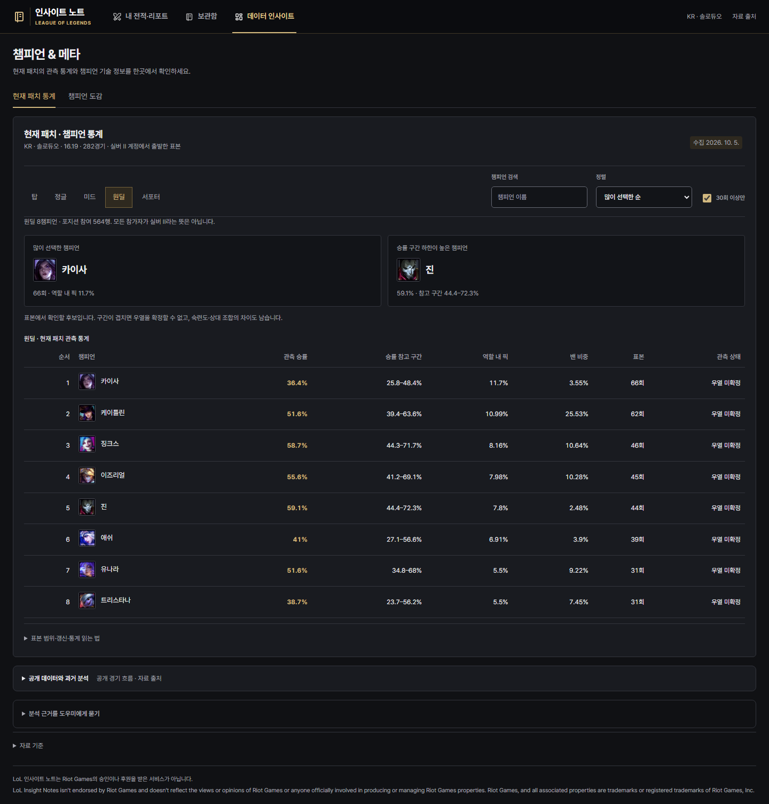
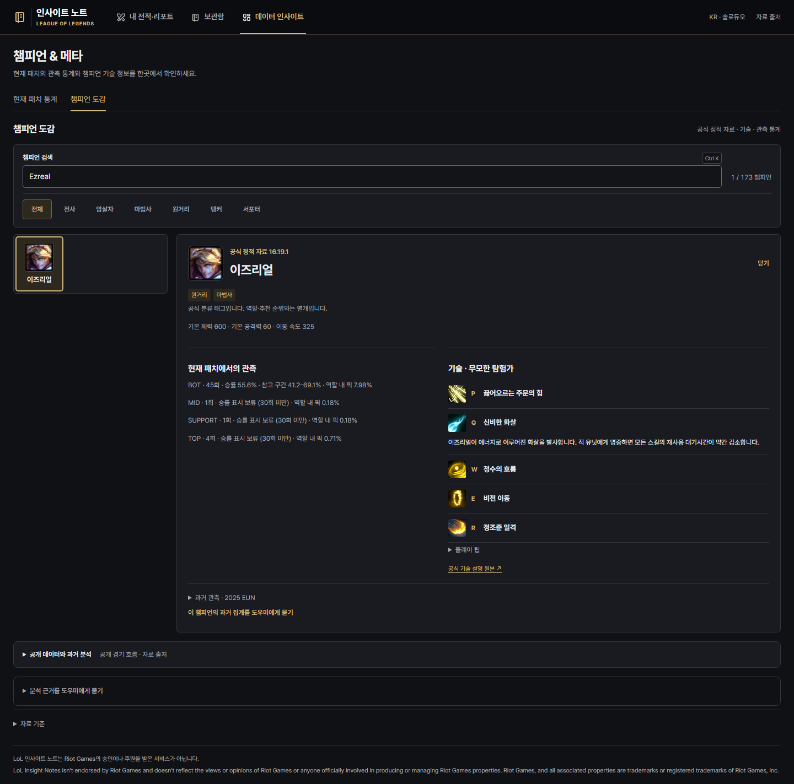

# 경기 탐색·현재 메타·Riot 수집 개선

2026-10-05 구현 기록. 기존 Gen.G 블랙·골드 테마와 개인 기록 보관 형식을 유지했다.

## 화면에서 달라진 점

- **내 전적·리포트**: 5/10경기 선택 조회 → 최근 승패·현재 랭크·조회 챔피언 요약 → 포지션으로 경기 선택 → 핵심 요약 / 팀 비교 / 시간대별 흐름.
- 모바일 경기 목록은 좌우로 넘기는 한 줄로 줄여 선택한 리포트까지의 스크롤을 줄였다. 좁은 화면의 통계 표에도 좌우 탐색 안내를 표시한다.
- 팀 비교는 소환사 이름 없이 10명의 챔피언·KDA·골드·챔피언 피해·시야를 표시한다. 본인 행을 강조한다.
- 흐름은 요청할 때만 공식 타임라인을 불러와 같은 포지션 상대와 골드·CS 차이, 실제 데스 시각을 보여준다. 10.01분 같은 실제 프레임 시각을 유지한다. 골드 차이가 플레이 원인을 확정하지 않는다.
- **데이터 인사이트**: 현재 패치 통계 / 챔피언 도감으로 구분했다. 포지션·검색·정렬·최소 표본 필터, 역할 내 픽 비중·승률 구간·밴 비중을 제공한다.
- 통계의 챔피언, 계정 요약의 챔피언, 경기 리포트의 챔피언 정보에서 도감으로 연결한다. 도감에는 공식 P/Q/W/E/R 설명과 플레이 팁이 있다. 과거 EUN 집계는 접힌 보조 정보로 남긴다.
- 공개 경기 흐름·과거 군집 분석·근거 도우미는 별도 접기 영역에 보존한다.

## 참고한 상용 서비스

| 출처 | 확인한 범위 | 반영 |
|---|---|---|
| [Blitz](https://blitz.gg/lol) | 2026-10-05 브라우저 HTTP 200, 화면 캡처 확인 | 계정 검색과 챔피언/메타 탐색 분리, 짧은 하위 탐색 |
| [LOL.PS 통계](https://lol.ps/statistics) | 앞선 작업의 현행 화면 캡처 확인 | 포지션 필터와 숫자 중심의 표 |
| [OP.GG 앱 공식 안내](https://help.op.gg/hc/en-us/articles/48467238743961-Getting-Started-with-the-OP-GG-App) | 공식 안내와 제공 이미지 확인. 메인 페이지 403 | 검색 중심 진입과 목록/상세 구조 |
| [Mobalytics 공식 가이드](https://mobalytics.gg/lol/guides/mobalytics-beginners-guide) | 공식 문서의 Profile/Post Game/Champions 설명 확인. 이번 브라우저 캡처는 403 | 계정 요약 → 경기 상세, 개인 챔피언과 전체 메타 연결 |
| [Porofessor 공식 소개](https://porofessor.gg/en/download) | 공식 소개의 상세 경기 분석·챔피언 메타 설명 확인. 브라우저 403 | 경기별 수치와 시간 흐름 분리 |

공개 안내에서 정보 구조를 참고했다. 보호된 페이지를 우회하지 않았으며 상용 서비스의 티어 점수·통계·이미지를 제품 데이터로 복제하지 않았다.

## 현재 패치 원자료 수집

공식 [League-V4 / Match-V5](https://developer.riotgames.com/apis)만 사용했다. 정적 자료 16.19.1의 앞 두 자리 **16.19**로 Match-V5 버전을 맞춘다. 공식 패치 노트의 표기는 **26.19**다.

첫 페이지를 해시 순으로 선택한 예비 수집은 비활동 계정이 많아 89경기를 확보했다. 최종 화면에는 별도 수집한 다음 표본을 사용한다.

| 항목 | 실제 결과 |
|---|---|
| 지역·큐·패치 | KR · 솔로듀오 420 · 16.19 |
| 출발 계정 | 현재 SILVER II 랭크 목록 1–3페이지에서 시즌 경기 수가 많은 순 40개, 동률은 PUUID 해시 순 |
| 경기 목록 범위 | 최근 7일 · 계정당 최대 20개 |
| 정규화한 경기 | **282경기 / 2,820참여 행** |
| 경기 종료 범위 | KST 2026-09-28–2026-10-05 (원본 시각은 UTC 저장) |
| 수집 요청 | 328회 · 실행 한도 650회 / 최대 500경기 |
| 승률 표시 대상 | 역할별 30회 이상인 18개 챔피언·역할 조합 |

이는 **실버 II 계정에서 출발한 편의 표본**이다. 모든 참가자가 실버 II이거나 경기 당시 티어가 확인됐다는 뜻이 아니다. 제한된 랭크 페이지·활동적인 출발 계정·반복 선수·매치업의 선택 편향이 남는다. 전체 KR 메타의 확정 티어를 발표할 표본은 아니다.

역할 내 픽 비중은 해당 역할 참여 행이 분모다. 282경기에서 각 역할은 564행이다. 밴 비중은 밴 정보가 확인된 경기 중 해당 챔피언이 밴된 경기의 비중이며, 같은 경기에서 중복 밴되면 한 번 센다. 승률의 Wilson 95% 참고 구간은 반복 선수·경기 내 의존성·다중 비교를 보정하지 않는다. 30회는 표시 기준이지 정밀도 보증이 아니다.

현재 BOT 표본에서 진은 44회·59.1%·참고 구간 44.4–72.3%, 징크스는 46회·58.7%·44.3–71.7%다. 구간이 넓고 겹쳐 확정적인 우열을 판단하지 않는다. 화면에서 확인할 후보와 관측 통계를 제공한다.

## 수집 구현과 공식 문헌·사례

[Riot 요청 제한 문서](https://developer.riotgames.com/docs/portal#rate-limiting)는 앱·메서드·서비스 제한을 구분하고, 429의 Retry-After 동안 호출을 중단하도록 설명한다. [RiotWatcher](https://riot-watcher.readthedocs.io/en/latest/)와 [Cassiopeia](https://github.com/meraki-analytics/cassiopeia)의 요청 예산·캐시 구성을 참고해 기존 경량 httpx 연동에 필요한 부분을 구현했다. 라이브러리를 새로 설치하거나 그대로 복사하지 않았다.

- 지역별 보수적 기본 예산과 `X-App-Rate-Limit[-Count]`, `X-Method-Rate-Limit[-Count]`를 반영한다. 원격 사용량이 한도에 도달하면 실제 요청 전에 대기 오류를 반환한다.
- 429는 재시도하지 않고 지역 호출을 중단한다. 수집기는 재실행에도 대기 시각을 체크포인트에서 유지한다. 인증 실패·404는 재시도하지 않는다. 수집기의 일시적 502 오류만 한 번 재시도한다.
- 계정 10분·랭크 2분·경기 목록 60초·완료 상세/타임라인 24시간의 메모리 캐시로 중복 다운로드를 줄인다. 전체 조회 결과는 기존 60초 캐시다. 캐시 상한은 128개, 개인 조회는 직렬화한다.
- `--matches`, `--max-calls`, `--seeds`, `--pages`, `--per-seed`, `--days`로 작업량을 제한한다. 요청 간격은 최소 1.6초, 기본 1.7초다.
- 경기 ID를 해시해 중복을 제거한다. 체크포인트에는 식별자가 제거된 참여 수치와 시각, 해시만 보관한다. 원본 JSON·PUUID·Riot ID·키는 저장하지 않는다.
- 큐·지역·패치·종료 시각·경기 길이·리메이크/조기 종료·정확한 10명/팀별 역할·승패·챔피언을 검증한다. 불명확한 밴 정보는 0으로 채우지 않는다.
- 집계와 체크포인트는 임시 파일을 쓴 뒤 원자적으로 교체한다. 공개용 집계는 `service/data/current_meta.json`, 수집 중간 상태는 Git 제외 `.local/`에 둔다.
- 집계 후 3일이 지나거나 정적 패치와 달라지면 화면에 갱신 필요를 표시한다. 자동 주기 수집은 아직 설정하지 않았다.

한 프로세스의 요청 예산 구현이다. 여러 서버/수집기를 대규모로 동시에 운영할 때는 키·지역별 공유 예산과 작업 큐가 필요하다. 이번 소량 실측은 시간 간격과 원격 카운트 헤더를 반영했다. 개인/개발 키로 공개 운영하지 않으며 공개 서비스 단계에는 Riot 프로덕션 키가 필요하다.

```powershell
python scripts/collect_riot_meta.py --seeds 40 --per-seed 20 --pages 3 --matches 500 --max-calls 650
```

같은 조건으로 재실행하면 유효 기간 안의 체크포인트를 이어 사용하고 중복을 건너뛴다. 수집 범위의 상한이 결과 경기 수를 보장하지 않는다. `--fresh`는 이 작업에서 생성한 수집 상태를 새로 시작한다. 서비스는 집계를 매 요청에 읽으므로 수집 완료 후 집계만 갱신할 때 서버를 재시작할 필요가 없다.

## 실제 계정 시뮬레이션과 한계

사용자가 지정한 본인 계정으로 10경기를 조회해 분석 가능 9경기, 제외 1경기를 확인했다. 계정 ID와 실제 화면·경기 수치는 공개 문서에 넣지 않았다. 10명 팀 비교, 공식 타임라인, 로컬 Qwen3-4B 질문 생성, 포지션 필터, 리포트 보관·재열람을 통과했고 브라우저 오류는 없었다. 실측 결과·화면은 Git 제외 `.local/account-simulation/`에만 둔다.

경기 연결 토큰은 서버 메모리에 30분 유지하고 타임라인은 필요할 때 한 번 요청한다. 보관함은 기존 개인 요약 형식을 유지하며 토큰·참가자 수치·계정 식별자는 보관하지 않는다. 저장된 요약을 다시 열어 팀 비교/흐름이 없으면 전적 재조회 안내를 표시한다.

로컬 모델의 질문 실행 성공은 코칭 품질의 증거가 아니다. 모델 입력은 기존 포지션·종료 지표만 사용하며 타임라인이나 개인정보를 전달하지 않는다. 타임라인과 지표의 연결을 학습한 모델·리플레이 이해 모델·전적 기반 실력 점수는 이번 범위에 포함하지 않는다.

## 검증

Python **42개** 단위 검증, Node **20개** 기록·리포트 보관 검증을 통과했다. 기존 브라우저 회귀 흐름에 소표본 표시·검색·정렬·메타/도감 연결·팀 비교·타임라인 1회 요청·포지션 빈 상태·키보드 탭 전환을 추가해 통과했다. 320/390/768/1024/1440/1920/2560px의 전체 메뉴와 새 보기에 가로 넘침이 없었고, 넓은 화면의 양쪽 여백은 대칭이었다. 공개 화면 캡처는 합성 개인 전적과 식별자 없는 실제 메타 집계만 사용한다.




