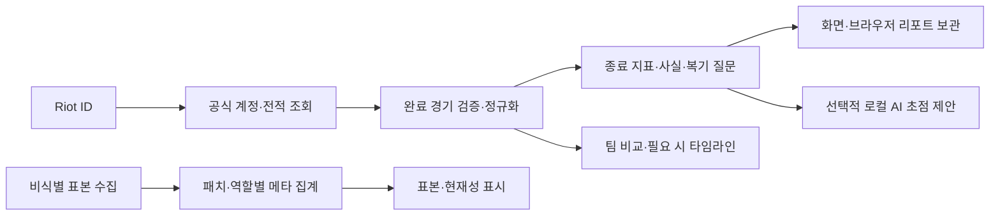

# 전적 중심 흐름과 서비스 기반 점검 — 2026-10-05

직접 입력 복기 화면을 제거하고 **Riot ID 조회 → 경기 선택 → 분석 리포트 → 보관·재열람**으로 진입 경로를 정리했다. 수치를 수동 입력으로 옮기는 버튼과 초안 자동 저장 연결도 제거했다. 기존 경기 기록·초안 저장소를 삭제하지 않았으며 기존 복기의 검색·수정·행동 상태·백업·복원은 유지한다. 과제와 분석 질문의 재사용은 자유 행동 노트로 연결한다.

단일 선택 드롭다운은 기본 키보드 동작을 유지하면서 화살표를 오른쪽 테두리에서 14px 안쪽에 두고 40px의 텍스트 여유를 확보한다. 조회 경기 수 선택은 모바일에서도 문구가 잘리지 않도록 폭과 글자 크기를 조정했다.

## 화면보다 먼저 확인할 기반

새 분석 서버를 중복 구축하지 않고 실제 구현된 경로와 의존성을 점검했다. [경기 탐색·Riot 수집 근거](17_match_explorer_and_riot_collection.md)의 공식 문헌과 수집 사례를 적용한 기존 구조를 사용한다.



| 기반 | 현재 구현과 확인 방법 |
|---|---|
| 수집 안정성 | 앱·메서드 요청 예산, 429 대기, 시간 제한, 용도별 메모리 캐시, 조회 직렬화 |
| 데이터 품질 | 지역·큐·패치·경기 종료·리메이크·역할 검증, 누락·미정의 수치를 0으로 대체하지 않는 지표 계산 |
| 분석 근거 | 종료 지표와 타임라인 분리, 실제 관측 사실과 복기 질문 구분, 소표본 승률 보류와 오래된 집계 안내 |
| 보관 | 식별자를 제외한 리포트 최대 50개, 기존 복기 최대 500개, 손상·용량 초과·다른 탭 변경 보호 |
| 장애 대응 | 조회 실패 안내·재시도, 요청 제한 대기 시간 표시, 타임라인 재시도, AI·참고 자료 실패와 기본 리포트 분리 |
| 검증 기반 | 로컬 준비 상태 점검 명령, Python·Node 검증, CI의 Chromium 브라우저 회귀 검증 |

## 추가한 준비 상태 점검

```powershell
python scripts/check_service_readiness.py
```

실행 중인 로컬 8001 서버의 HTML·실제로 연결된 JavaScript/CSS·캐시 정책·분석 자료·챔피언 목록·현재 메타·공개 참고 자료·전적 설정·AI 설치 상태를 검사한다. 필수 파일이나 핵심 분석 연결이 실패하면 `failed`와 종료 코드 1을 반환한다. 키 미설정·AI 미설치·갱신이 필요한 메타·선택 참고 자료 장애는 `limited`로 구분한다. 모두 확인하면 `ok`다.

계정을 조회하거나 모델을 실행하지 않으며 키·응답 원문·개인 전적은 보고서에 출력하지 않는다. **설정 및 설치 확인은 키 유효성·추론 성공·분석 품질을 검증한 결과가 아니다.** 기본 화면 준비 상태와 실제 외부 연결의 검증 범위를 구분한다.

## 검증 결과와 다음 기반 작업

Python 46개와 Node 20개 검증, 브라우저의 전체 메뉴·리포트·보관·기존 기록·과제 재사용 흐름을 확인했다. 브라우저 검증에 503 실패, 429 대기 안내, 빈 전적, 재조회 복구, 320~2560px 드롭다운·가로 넘침 검사를 추가했다. 공개 참고 자료 장애에서도 전적 리포트를 생성한다. 기존 초안은 직접 입력 화면 제거 이후에도 그대로 보존한다.

로컬 준비 상태 점검의 16개 항목은 통과했다. 화면 캡처는 합성 계정과 전적만 사용했다. GitHub Actions에 브라우저 검증을 추가했으며 원격 Actions 실행은 이 작업에서 수행하지 않았다.

현재 기반은 본인용 단일 로컬 서버다. 자동 표본 갱신 작업, 여러 프로세스의 공유 요청 예산·작업 큐, 계정별 서버 저장소·인증, 자동 리포트 백업은 아직 구현하지 않았다. 다음 고도화는 리포트 보관의 백업·복구부터 설계하고, 운영 방식이 정해지면 저장소와 작업 큐를 확장하는 순서다. 화면에는 현재 실제로 연결된 분석과 이용 가능한 상태만 표시한다.
