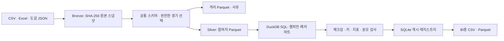

# 과거 경기 데이터 파이프라인

이 배치는 CSV·Excel 경기 자료와 공식 챔피언 도감 JSON을 고정된 입력으로 보관하고, 검증을 통과한 Parquet·CSV 마트를 게시한다. 기존 연구용 DB·분석 결과·개인 복기 저장소와 독립적으로 실행한다. [프로젝트 검토·후속 순서](24_project_review.md)

## 처리 구조



처음 파일을 불변 스냅샷으로 적재한 뒤 Python에서 정규화하고 DuckDB SQL로 집계한다. 원본 보관 이후 변환한다는 ELT 요소와 Python ETL 처리를 함께 가진 배치다. 현재 범위는 파일 스냅샷의 파티션 재구성이며 행 단위 CDC·실시간 스트리밍은 구현하지 않았다.

## 입력·산출 계약

| 단계 | 입력·산출 | 규칙 |
| --- | --- | --- |
| extract | `2025.csv`, `2024.xlsx`, 도감 JSON → `bronze/<sha256>/`, 스냅샷 JSON | 배치 날짜에 최초 입력 고정, 재시도에서 원본 경로를 다시 읽지 않음 |
| transform | 스냅샷 → `runs/<batch-date>/<attempt>/` | 기존 패치·큐·역할 정규화 재사용, 새 마트의 완전성 조건 적용 |
| quality | 파일 해시·실제 Parquet·마트 → `quality.json` | 실패 시 예외를 발생시켜 게시 차단 |
| publish | 검증된 실행 디렉터리 → `registry.sqlite` | 트랜잭션 UPSERT, 날짜당 게시본 1개, 조회 시 가장 큰 날짜 선택 |

`batch_date`는 **입력을 묶은 날짜**다. 과거 경기의 발생 날짜나 데이터 최신성을 뜻하지 않는다. 마트의 `patch`는 원본 게임 버전의 앞 두 자리이며, 공식 패치 노트 번호와 섞지 않는다.

이 배치는 과거 EUN 표본을 대상으로 한다. 도감 16.19.1은 한국어 이름 연결에만 사용하며, 과거 경기의 능력치·아이템·밸런스를 재현하는 자료로 사용하지 않는다.

### 품질 규칙

- 중복 `(patch, game_id, participant_id)`, 필수 값 누락, 음수·비유한 수치·잘못된 승패·참여자 번호·팀 값은 배치를 실패시킨다. 기존 로더의 기본 동작은 유지하며, 새 배치는 `strict=True`를 사용한다.
- 참가자 10명·승자 5명·팀당 5명·팀당 역할 5종·동일 경기 시간·5–90분을 충족하지 못한 경기는 전체를 격리한다. 원본을 삭제하지 않는다.
- 격리 사유는 `quarantine_reason`과 `audit.quarantined_games_by_reason`에 남는다. 여러 사유를 가진 경기가 있으므로 사유별 건수 합계와 격리 경기 수가 다를 수 있다.
- 파생 KDA·GPM·DPM·KP는 검증한 경기에서 다시 계산한다. 팀 킬이 0일 때 KP는 NULL로 남긴다.
- 전체 표본과 공통 티어 `PLATINUM·EMERALD·DIAMOND`를 별도로 집계한다. 픽 비중은 같은 패치·코호트·역할의 참여 행이 분모다.
- 챔피언·역할 표본 30건 미만은 승률·Wilson 구간을 NULL로 남긴다. 픽 표본 수와 비중은 표시할 수 있다.
- 검사 단계에서 참여 행과 마트 표본의 일치, 픽 비중 합, 작은 표본 억제, 파일 해시를 확인한다. 게시 직전에도 해시와 규칙을 재검사한다.

Wilson 구간은 반복 선수·경기 내 의존성·다중 비교를 보정한 결과가 아니다. 경기 격리 기준 역시 분석 설계 선택이므로 기존 결과와 비교할 때 모집단 차이를 설명해야 한다.

## 로컬 실행

Python 3.11 이상에서 저장소 루트 기준으로 실행한다. 실제 키나 서비스 전체 의존성은 필요하지 않다.

```powershell
python -m pip install -r pipeline/requirements.txt

# 합성 경기 64개·640행. 실제 배치와 별도인 .local/pipeline/demo/에 저장.
python scripts/run_data_pipeline.py --demo --batch-date 2026-11-17
python scripts/run_data_pipeline.py --demo --status

# 로컬에 원본 두 파일이 있는 경우에만 실행.
python scripts/run_data_pipeline.py --batch-date 2026-11-17
python scripts/run_data_pipeline.py --status

# 정정된 입력 또는 변경된 변환 코드·SQL로 같은 날짜를 다시 처리.
python scripts/run_data_pipeline.py --batch-date 2026-11-17 --refresh-snapshot
```

같은 날짜의 기본 재실행은 처음 입력을 사용한다. 변환 코드·SQL의 해시가 바뀌면 변환 단계가 실패하므로, 변경을 검토한 후 `--refresh-snapshot`을 명시한다. 스냅샷에는 원본과 코드 해시를 기록하며, 예전 코드 실행 자체는 해당 Git 커밋으로 재현해야 한다. 런타임 패키지의 완전한 환경 잠금은 후속 범위다.

### 성공본 읽기

```python
from pathlib import Path

import duckdb

from pipeline.historic import status

work = Path('.local/pipeline')
latest = status(work)['latest']
if latest is None:
    raise RuntimeError('검증을 통과한 게시본이 없습니다.')
run = work / latest['run_dir']
with duckdb.connect(':memory:') as db:
    mart = db.read_parquet(str(run / 'champion_patch.parquet')).df()
    print(mart[['patch', 'cohort', 'role', 'games']].groupby(['patch', 'cohort', 'role']).sum())
```

BI에는 같은 실행 디렉터리의 `champion_patch.csv`와 `patch_health.csv`를 연결한다. 파일 시스템의 가장 최근 디렉터리를 임의로 선택하면 실패한 실행을 읽을 수 있으므로 게시 레지스트리를 먼저 조회한다. 기존 웹서비스는 이 마트를 자동으로 읽지 않는다.

| 산출물 | 내용 |
| --- | --- |
| `participants.parquet` | 검증된 경기×참여자, 공통 원본 열·파생 지표·한국어 이름 |
| `quarantine.parquet` | 제외한 경기의 참여 행과 격리 사유. 로컬 조사용 |
| `champion_patch.parquet` · `.csv` | 패치·코호트·역할·챔피언별 표본·승수·분모·픽 비중·승률·Wilson 구간 |
| `patch_health.csv` | 패치별 경기 수·참여 행·평균 시간·GPM·DPM·누락 티어·NULL KP |
| `manifest.json` | 입력·변환 버전·해시·행 수·격리 수·파일 해시 |
| `quality.json` | 게시 조건 검사 결과와 감사 요약 |
| `registry.sqlite` | 날짜별 고정 입력, 단계별 시도·성공·실패와 게시본 |

실제 데이터와 실행 산출물은 Git 제외 경로 `.local/` 아래에 둔다. CI는 합성 입력만 생성한다.

## Airflow 실행 구성

[Airflow 공식 안내](https://airflow.apache.org/docs/apache-airflow/stable/installation/prerequisites.html)에 따라 Windows에서는 Linux 컨테이너 또는 WSL2를 사용한다. 이번 구성은 **로컬 학습용 단일 노드**다. SQLite 레지스트리와 공유 로컬 볼륨을 사용하며 분산 작업자용 객체 저장소·운영용 인증·모니터링은 별도 설계가 필요하다.

```powershell
docker compose -f orchestration/airflow/compose.yml up --build -d
docker compose -f orchestration/airflow/compose.yml logs airflow
```

브라우저에서 `http://localhost:8080`을 열고, standalone 로그의 로컬 로그인 안내를 따른다. `lol_historic_pipeline`을 활성화한 뒤 Trigger에서 `demo=true`, `batch_date=2026-11-17`로 실행한다. 실제 원본 실행은 로컬 원본이 있을 때 `demo=false`를 선택한다. 외부 배포나 키 등록은 필요하지 않다.

```text
extract_snapshot
  → normalize_and_build_marts
  → quality_gate
  → publish_batch
```

- Airflow 3.4.0 공식 이미지와 `airflow.sdk` TaskFlow API를 사용한다.
- Task 파싱 때 데이터를 읽거나 서비스를 초기화하지 않는다. pandas·DuckDB는 작업 함수 안에서 불러온다.
- XCom에는 스냅샷·실행 경로와 작은 집계 요약만 전달한다. DataFrame·실제 경기 행·키는 전달하지 않는다.
- 재시도는 2회, 실행 제한은 작업당 15분, 동시 DAG Run은 1개다. 실패를 성공으로 덮는 `all_done` 최종 작업을 두지 않는다.
- 과거 고정 파일을 매일 재적재할 이유가 없으므로 **수동 실행**으로 시작한다. 최신 API 수집의 기간·체크포인트 계약을 만든 후 주기를 연결한다.
- Airflow 전용 Docker ignore는 배치 코드·필요한 SQL만 빌드 컨텍스트에 포함한다. 원본·개인 파일·모델·서비스 환경 파일은 이미지에 넣지 않는다.

현재 PC에는 Docker와 설치된 WSL 배포판이 없어 컨테이너 실기동을 로컬에서 검증하지 못했다. `.github/workflows/pipeline.yml`에 이미지 빌드와 실제 `DagBag` 파싱·`dag.test()`를 추가했다. CI 등록과 실제 실행 성공 여부는 구분해 확인한다.

## 실패·복구 절차

| 상황 | 결과 | 처리 |
| --- | --- | --- |
| 원본 누락·스키마 변경 | 해당 단계 실패·기존 게시본 유지 | 입력 계약을 확인하고 같은 배치의 정정 스냅샷 생성 |
| 중복 키·잘못된 필수 값 | 변환 실패·기존 게시본 유지 | 원본에서 원인을 수정하고 명시적 정정 실행 |
| 일부 경기의 불완전성 | 경기 전체 격리, 두 패치 모두 정상 경기가 있으면 계속 | 격리 파일·사유 수를 보고 필터의 타당성 점검 |
| 스냅샷·산출물 체크섬 불일치 | 변환 또는 게시 실패 | 성공본을 보존하고 손상된 실행을 조사 |
| 과거 날짜 재처리 | 해당 날짜 게시본만 갱신 | 최신 날짜 게시본은 유지 |
| 프로세스 강제 종료 | 게시 트랜잭션 전 자료는 소비하지 않음 | Airflow 작업 상태와 `running` 감사 행을 함께 확인하고 재시도 |

성공본으로 게시한 디렉터리는 이후 직접 수정하지 않는 계약이다. 배치 파일의 수명·보관 기간·용량 정리는 아직 자동화하지 않았다. 날짜별 전체 재구성이므로 대규모 일별 이벤트 로그에 그대로 적용할 때는 객체 저장소·파티션 전략·동시성 설계를 추가해야 한다.

## 검증 범위

합성 검사에서는 표본 분모·30건 기준, Wilson 구간, 동일 배치 재실행, 원본 경로 변경 후 최초 입력 재사용, 경기 전체 격리, 이름 연결, 중복·음수·NULL·비유한 값·소수 승패 거부, 실패 후 성공본 보존, 과거 재처리와 게시 전 파일 변조 차단을 확인한다.

실제 원본 검증은 기존 필터 후 83,566행에서 158경기·1,566행을 격리하여 8,200경기·82,000행을 게시했다. 패치 15.1은 2,029경기·20,290행, 15.3은 6,171경기·61,710행이다. 이름 연결 누락은 0행이다. 합성 예제는 64경기·640행이다. [개인 행·경로를 제외한 실제 검증 요약](data_pipeline_validation.json)

| 격리 조건 | 해당 경기 수 |
| --- | --- |
| 참여자 10명 미충족 | 14 |
| 5–90분 범위 이탈 | 40 |
| 같은 팀의 역할 중복 | 111 |
| 팀 인원·구성 불일치 | 14 |
| 승자 수 또는 경기 시간 값 불일치 | 0 |

여러 조건에 해당하는 경기가 있어 위 수치는 합산하지 않는다. 기존 DB의 SHA-256이 배치 전후 동일함을 확인했으며 `outputs/`는 수정하지 않았다.

로컬 Python 전체 검사는 **89개 통과·5개 건너뜀**이다. 건너뛴 5개는 실제 Redis 실행 주소가 필요한 검사다. 새 파이프라인 검사는 16개이며 기존 적재·분석 검사와 함께 21개가 통과했다. 전체 Ruff lint와 `service/`·`src/` Mypy도 통과했다. 새 파일과 수정한 로더의 포맷 검사는 통과했고, 전체 작업본 포맷 검사에서는 이번 변경 밖의 기존 미커밋 파일 6개가 실패했다. 해당 파일은 보존했다.

커밋할 인덱스만 LF 줄바꿈으로 별도 내보낸 검증본에서는 **77개 테스트 전부 통과**, 합성 CLI 실행, 전체 Ruff lint·포맷 검사도 통과했다. 이 검증본에는 비공개 원본과 작업 시작 전의 미커밋 변경을 포함하지 않았다.

Airflow의 실제 실행 결과는 Linux CI에서 별도로 확인해야 한다. 위 Python 검사 통과를 Airflow 운영·실기동 성공으로 확대해서 설명하지 않는다.
